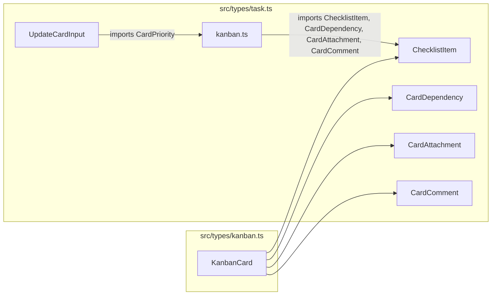

# Nexora Frontend — Priority Audit Findings Verification Report

**Date:** 2026-10-14  
**Investigator:** Senior Frontend Engineer & Software Architect  
**Project:** Nexora Frontend  
**Scope:** In-depth evidence verification of findings CC-001, CC-002, CC-005, and CC-008 from `docs/audit/frontend-code-quality-audit.md`  
**Branch:** `refactor/frontend-codebase`  
**Execution Mode:** Strictly Read-Only Investigation  

---

## 1. Repository and Git Baseline

- **Repository Root:** `D:/Document/TÀI LIỆU ĐỒ ÁN 1/Nexora/Frontend`
- **Active Git Branch:** `refactor/frontend-codebase`
- **Initial Working Tree State:**
  - **Modified (14):** `src/apis/workspace.api.ts`, `src/components/kanban/KanbanCard.tsx`, `src/components/kanban/detail/CardDetailActivity.tsx`, `src/components/kanban/detail/CardDetailMetadata.tsx`, `src/components/workspace/CreateWorkspaceModal.tsx`, `src/mappers/board.mapper.ts`, `src/mappers/card.mapper.ts`, `src/mappers/workspace.mapper.ts`, `src/types/index.ts`, `src/types/task.ts`, `src/types/workspace.ts`, `src/utils/__tests__/format.test.ts`, `src/utils/format.ts`, `src/utils/index.ts`.
  - **Deleted / Reorganized (5):** `src/types/api.ts`, `src/types/board.dto.ts`, `src/types/card.dto.ts`, `src/types/list.dto.ts`, `src/types/workspace.dto.ts`.
  - **Untracked (7):** `docs/audit/frontend-code-quality-audit.md`, `src/constants/index.ts`, `src/constants/workspace.ts`, `src/types/api/`, `src/types/dto/`, `src/utils/__tests__/date.test.ts`, `src/utils/date.ts`.
- **Integrity Guarantee:** Zero source code, test, configuration, package, or backend files were altered during this verification pass.

---

## 2. Summary of Findings Verification Status

| ID | Stated Concern in Audit | Verification Result | Severity Assessment | Summary of Verified Evidence |
|:---:|---|:---:|:---:|---|
| **CC-001** | `CardDetailDrawer` has approximately 46 props and acts as a prop-drilling multiplexer | **Confirmed Issue** | **High** | Declares exactly **49 props** in `CardDetailDrawerProps`. Only 3 are used directly (`card`, `isOpen`, `onClose`); the remaining 46 are forwarded down into 7 subcomponents. |
| **CC-005** | `src/apis/card.api.ts` is ~541 lines and contains too many responsibilities | **Confirmed Issue** | **High** | Spans **541 lines** with **31 methods** covering 8 distinct domain resources (cards, checklists, assignments, labels, comments, attachments, dependencies, activities). Directly invokes domain mappers while consumer hooks only use 3–4 methods each. |
| **CC-008** | Circular type dependency between `src/types/task.ts` and `src/types/kanban.ts` | **Confirmed Issue** | **Medium** | `task.ts:2` imports `CardPriority` from `kanban.ts`, while `kanban.ts:2-7` imports `ChecklistItem`, `CardDependency`, `CardAttachment`, `CardComment` from `task.ts`. Verified by AST circular dependency detector. |
| **CC-002** | Large landing page components (~645 lines) are unused or unreachable | **Confirmed Issue (with Nuance)** | **Medium-High** | 3 components (`LandingFeatureDetail.tsx` 467 lines, `LandingPillars.tsx` 100 lines, `LandingSummaryCards.tsx` 103 lines = **670 lines total**) are completely unreferenced in routes, pages, or tests. Rollup successfully tree-shakes them out of the production bundle, but they exist as dead source code that must be compiled and maintained. |

---

## 3. CC-001 — Detailed Evidence for `CardDetailDrawer` Prop Count & Boundaries

### 3.1. Verified Prop Inventory
In [src/components/kanban/detail/CardDetailDrawer.tsx](file:///d:/Document/TÀI%20LIỆU%20ĐỒ%20ÁN%201/Nexora/Frontend/src/components/kanban/detail/CardDetailDrawer.tsx#L21-L74), `CardDetailDrawerProps` declares exactly **49 properties**:

1. **Directly Handled by Drawer (3 props):**
   - `card: KanbanCard | null` (used for null-guard line 127 and accessible title line 142)
   - `isOpen: boolean` (passed to Radix `Dialog.Root open`)
   - `onClose: () => void` (passed to Radix `Dialog.Root onOpenChange`)

2. **Pass-Through Props Forwarded to Children (46 props):**
   - **To `CardDetailHeader` (3 props):** `onUpdate`, `onDelete`, `onClose`.
   - **To `CardDetailMetadata` (15 props):** `lists`, `members`, `onStatusChange`, `onUpdate`, `onAssignMember`, `onUnassignMember`, `isLoadingAssignments`, `assignmentsError`, `onRetryAssignments`, `boardLabels`, `onAttachLabel`, `onDetachLabel`, `isLoadingLabels`, `labelsError`, `onRetryLabels`.
   - **To `CardDetailDescription` (1 prop):** `onUpdate`.
   - **To `CardDetailChecklist` (6 props):** `onAddChecklistItem` (aliased as `onAddItem`), `onToggleChecklistItem` (aliased as `onToggleItem`), `onDeleteChecklistItem` (aliased as `onDeleteItem`), `isLoadingTasks` (aliased as `isLoading`), `tasksError` (aliased as `error`), `onRetryTasks` (aliased as `onRetry`).
   - **To `CardDetailDependencies` (7 props):** `boardCards`, `canManageDependencies` (aliased as `canManage`), `isLoadingDependencies` (aliased as `isLoading`), `dependenciesError` (aliased as `error`), `onRetryDependencies` (aliased as `onRetry`), `onAddDependency`, `onDeleteDependency`.
   - **To `CardDetailAttachments` (10 props):** `onUploadAttachment`, `onDeleteAttachment`, `onDownloadAttachment`, `isLoadingAttachments`, `attachmentsError`, `onRetryAttachments`, `isUploadingAttachment`, `currentUserId`, `currentUserRole`, `isWorkspaceOwner`.
   - **To `CardDetailActivity` (8 props):** `onAddComment`, `onFetchActivities`, `onUpdateComment`, `onDeleteComment`, `isLoadingComments`, `commentsError`, `onRetryComments`, `currentUserId`.

### 3.2. Call Sites & Coupling Analysis
- **Production Call Sites:** Exactly **1 call site** in the entire application: [src/pages/boards/BoardDetailPage.tsx:273-323](file:///d:/Document/TÀI%20LIỆU%20ĐỒ%20ÁN%201/Nexora/Frontend/src/pages/boards/BoardDetailPage.tsx#L273-L323).
- **Test Call Sites:** 8 test invocations in [src/components/kanban/detail/__tests__/CardDetailDrawer.test.tsx](file:///d:/Document/TÀI%20LIỆU%20ĐỒ%20ÁN%201/Nexora/Frontend/src/components/kanban/detail/__tests__/CardDetailDrawer.test.tsx).
- **Data Origin:** `BoardDetailPage` obtains all 36+ callback and state properties from `useBoardDetail(boardId)`, which in turn merges canvas mutations (`useBoardCardMutations`) and sub-entity operations (`useCardSubEntities`).

### 3.3. Evaluation & Responsibility Mapping

| Evidence | Current Responsibility | Actual Problem | Recommended Direction | Confidence |
|---|---|---|---|:---:|
| 49 declared props; 46 forwarded verbatim to 7 children | Multiplexing all card mutation callbacks and status flags | High coupling: modifying any single child component's API (e.g. adding attachment retry) requires altering `useCardSubEntities`, `useBoardDetail`, `BoardDetailPage`, and `CardDetailDrawer`. | Introduce a scoped `CardDetailContext` or consume sub-entity hooks inside drawer child components. | **High** |
| `boardCards` & `canManageDependencies` passed through drawer | Permission & prerequisite card list passing | Redundant prop drilling: `canManageDependencies` is computed in `BoardDetailPage` and drilled 2 levels down. | Encapsulate permission calculation in a `useBoardPermissions` hook or via Context. | **High** |
| Repeated (isLoading, error, onRetry) triplets across 5 domains | Propagating async status for tasks, assignments, labels, comments, dependencies, attachments | Massive prop explosion (6 error strings, 6 booleans, 6 retry callbacks = 18 props). | Bundle sub-entity state objects or access state via context. | **High** |

---

## 4. CC-005 — Detailed Evidence for `src/apis/card.api.ts` Responsibilities

### 4.1. Structural Metrics
- **Actual File Length:** **541 lines** (15,482 bytes).
- **Total Exported Methods in `cardApi`:** **31 methods**.
- **External Dependencies:** Imports 9 mapping functions from `src/mappers/card.mapper.ts`.

### 4.2. Method Inventory by Resource Domain

| Existing Method / Group | Current Responsibility | Proposed Destination Module | Compatibility Risk |
|---|---|---|:---:|
| **Card Core Lifecycle (8 methods)**<br>`getBoardCards`, `getCardById`, `createCard`, `updateCard`, `moveCard`, `archiveCard`, `restoreCard`, `deleteCard` | Core Kanban card CRUD, movement between columns, and archive state | `src/apis/card.api.ts` | **Zero:** Remains canonical home for card operations. |
| **Checklist / Tasks (4 methods)**<br>`getCardTasks`, `addChecklistItem`, `updateChecklistItem`, `deleteChecklistItem` | Task item management under `/cards/:id/tasks` and `/tasks/:id` | `src/apis/card-task.api.ts` (or `task.api.ts`) | **Low:** Re-exported through `cardApi` facade to prevent consumer breaks. |
| **Assignments (3 methods)**<br>`getCardAssignments`, `assignCardMember`, `unassignCardMember` | Member assignment under `/cards/:id/assignments` | `src/apis/card-assignment.api.ts` | **Low:** Re-exported through `cardApi` facade. |
| **Labels (4 methods)**<br>`getBoardLabels`, `getCardLabels`, `attachCardLabel`, `detachCardLabel` | Label associations under `/boards/:id/labels` and `/cards/:id/labels` | `src/apis/card-label.api.ts` | **Low:** Re-exported through `cardApi` facade. |
| **Comments (4 methods)**<br>`getCardComments`, `createCardComment`, `updateCardComment`, `deleteCardComment` | Discussion comments under `/cards/:id/comments` and `/comments/:id` | `src/apis/card-comment.api.ts` (or `comment.api.ts`) | **Low:** Re-exported through `cardApi` facade. |
| **Attachments (4 methods)**<br>`getCardAttachments`, `uploadCardAttachment`, `downloadCardAttachment`, `deleteCardAttachment` | Multipart file upload, binary blob download, and attachment deletion | `src/apis/card-attachment.api.ts` | **Low:** Re-exported through `cardApi` facade. |
| **Dependencies (3 methods)**<br>`getCardDependencies`, `addDependency`, `deleteDependency` | Directed acyclic prerequisite links under `/cards/:id/dependencies` | `src/apis/card-dependency.api.ts` | **Low:** Re-exported through `cardApi` facade. |
| **Activity Log (1 method)**<br>`getCardActivities` | Cursor-paginated audit trail under `/cards/:id/activities` | `src/apis/card-activity.api.ts` | **Low:** Re-exported through `cardApi` facade. |

### 4.3. Layer Boundary Inconsistencies Found
1. **Asymmetric Mapping:**
   - Methods like `getBoardCards`, `createCard`, `getCardTasks`, `getCardDependencies`, and `getCardActivities` call mappers internally and return domain models (`KanbanCard`, `ChecklistItem`, `CardDependency`, `CardActivity`).
   - Conversely, `getCardAssignments`, `getCardComments`, and `getCardAttachments` return **raw backend DTOs** (`CardAssignmentDto[]`, `CommentDto[]`, `AttachmentDto[]`).
   - **Reason:** The mappers for comments, assignments, and attachments require the board's member directory (`board.members`) to resolve author details, which `card.api.ts` does not possess. This causes an inconsistent API contract where some methods return domain models and others return DTOs.
2. **Consumer Segregation:**
   - Consumers in `src/hooks/board/sub-entities/` (`useCardAssignments`, `useCardAttachments`, `useCardComments`, `useCardDependencies`, `useCardLabels`, `useCardTasks`) each only utilize 3–4 specific methods, yet all import the entire 541-line API object.

---

## 5. CC-008 — Detailed Evidence for Circular Type Dependency

### 5.1. Verified Dependency Cycle
Static inspection and automated AST traversal confirm an active circular import between `src/types/task.ts` and `src/types/kanban.ts`.



### 5.2. Exact Code Evidence
- In [src/types/task.ts:2](file:///d:/Document/TÀI%20LIỆU%20ĐỒ%20ÁN%201/Nexora/Frontend/src/types/task.ts#L2):
  ```ts
  import type { CardPriority } from "./kanban";

  export interface UpdateCardInput {
    title?: string;
    description?: string | null;
    startDate?: string | null;
    dueDate?: string | null;
    priority?: CardPriority; // <-- Creates dependency on kanban.ts
    assigneeIds?: string[];
    labelIds?: string[];
    updatedAt: string;
  }
  ```
- In [src/types/kanban.ts:2-7](file:///d:/Document/TÀI%20LIỆU%20ĐỒ%20ÁN%201/Nexora/Frontend/src/types/kanban.ts#L2-L7):
  ```ts
  import type {
    ChecklistItem,
    CardDependency,
    CardAttachment,
    CardComment,
  } from "./task"; // <-- Creates dependency on task.ts
  ```

### 5.3. Analysis & Evaluation
- **Runtime Impact:** **Zero.** Both files utilize TypeScript `import type`, meaning these imports are fully stripped during compilation.
- **Architectural & Maintenance Impact:** **Medium.**
  - `UpdateCardInput` represents payload fields for modifying a card (title, dates, priority, labels, updatedAt). It was misplaced into `src/types/task.ts`.
  - Checklists, comments, and attachments are child entities of a card.
  - Because `UpdateCardInput` resides in `task.ts`, `task.ts` is forced to import `CardPriority` from `kanban.ts`.
- **Simplest Resolution:** Move `UpdateCardInput` from `src/types/task.ts` into `src/types/kanban.ts` (or `src/types/card.ts`). Once moved, `task.ts` has zero imports from `kanban.ts`, completely breaking the cycle without adding any new abstraction layer.

---

## 6. CC-002 — Detailed Evidence for Unused Landing Page Components

### 6.1. Verified File Inventory
Three components in `src/components/landing/` were investigated:
1. `LandingFeatureDetail.tsx`: **467 lines** (Task management, dependency tracking, checklists showcase)
2. `LandingPillars.tsx`: **100 lines** (Three-pillar architecture showcase)
3. `LandingSummaryCards.tsx`: **103 lines** (Fast iterations, grounded intelligence showcase)
- **Combined Total:** **670 lines of code**.

### 6.2. Reachability & Usage Verification Table

| Check Performed | Evidence Found | Conclusion | Confidence |
|---|---|---|:---:|
| **Direct Component Import** | Searched entire `src/` for `LandingFeatureDetail`, `LandingPillars`, `LandingSummaryCards`. Only matches are their own declarations and re-exports in `src/components/landing/index.ts`. | **Zero imports** in any page or component. | **High** |
| **Route Reachability** | Inspected `src/routes.tsx`. Only one public marketing route exists: `ROUTES.LANDING` (`/`), which renders `<LandingPage />`. | **Unreachable:** None of these 3 components are wired to any route. | **High** |
| **Page Template Inclusion** | Inspected `src/pages/LandingPage.tsx`. It explicitly renders `LandingNavbar`, `LandingHero`, `LandingAiDarkSection`, `LandingTeamsSection`, `LandingBentoGrid`, `LandingStatsAndQuotes`, `LandingEcosystem`, `LandingCta`, and `LandingFooter`. | **Unrendered:** Excluded from the Landing page JSX tree. | **High** |
| **Dynamic / Lazy Imports** | Searched for `React.lazy`, `import(`, or string-based dynamic loader references across all files. | **Zero dynamic imports** match these components. | **High** |
| **Test Suite Usage** | Searched `src/**/__tests__/*` for any reference or mock. | **Zero test references.** | **High** |
| **Production Bundle Inclusion** | Inspected Vite production build bundle `dist/assets/index-*.js` using Node string matching for unique copy ("Plan work your way", "Flexible Kanban and list views", "Core Pillars"). | **Tree-shaken out:** Because `LandingPage.tsx` imports named symbols and these 3 are never imported, Rollup safely eliminated them from the client JavaScript bundle. | **High** |

### 6.3. Nuanced Conclusion for CC-002
- **Confirmed Fact:** The 3 components (670 lines) are completely dead in the source tree and never rendered in the browser.
- **Important Nuance:** Contrary to initial assumptions, **they do NOT bloat the production bundle** because modern ESM tree-shaking safely excludes them during `vite build`.
- **Maintenance Cost:** They remain a burden on developer cognitive load, TypeScript compilation cycles, and ESLint linting passes.

---

## 7. Prioritized Findings and Recommended Next Actions

| ID | Issue | Verified Classification | Practical Risk | Recommended Remediation | Complexity |
|:---:|---|:---:|---|---|:---:|
| **CC-001** | `CardDetailDrawer` 49 props | **Confirmed Issue** | High coupling; brittle refactoring of card sub-features | Step 2A: Introduce `CardDetailContext` or encapsulate sub-entity hooks inside drawer children. | Medium |
| **CC-005** | `card.api.ts` 31-method God API | **Confirmed Issue** | Violates SRP; asymmetric DTO/domain returns; hook coupling | Step 2B: Segment into resource API modules (`card.api.ts`, `task.api.ts`, `comment.api.ts`, etc.) while maintaining a backward-compatible facade. | Medium |
| **CC-008** | Circular type dependency | **Confirmed Issue** | Boundary violation; potential bundler/transpiler friction | Step 2C: Move `UpdateCardInput` from `task.ts` to `kanban.ts`, eliminating the cycle immediately. | Low |
| **CC-002** | 670 lines of dead landing code | **Confirmed Issue** | Developer confusion, unnecessary compilation/lint overhead | Step 2D: Remove `LandingFeatureDetail.tsx`, `LandingPillars.tsx`, and `LandingSummaryCards.tsx` along with barrel exports. | Low |

---

## 8. File Classification: Refactor, Retain, or Investigate Further

### Files to Refactor (in subsequent implementation phases)
- [src/components/kanban/detail/CardDetailDrawer.tsx](file:///d:/Document/TÀI%20LIỆU%20ĐỒ%20ÁN%201/Nexora/Frontend/src/components/kanban/detail/CardDetailDrawer.tsx): Decouple into context or modular sub-features.
- [src/pages/boards/BoardDetailPage.tsx](file:///d:/Document/TÀI%20LIỆU%20ĐỒ%20ÁN%201/Nexora/Frontend/src/pages/boards/BoardDetailPage.tsx): Strip the 36-prop drilling chain.
- [src/apis/card.api.ts](file:///d:/Document/TÀI%20LIỆU%20ĐỒ%20ÁN%201/Nexora/Frontend/src/apis/card.api.ts): Break into resource-specific API clients.
- [src/types/task.ts](file:///d:/Document/TÀI%20LIỆU%20ĐỒ%20ÁN%201/Nexora/Frontend/src/types/task.ts) & [src/types/kanban.ts](file:///d:/Document/TÀI%20LIỆU%20ĐỒ%20ÁN%201/Nexora/Frontend/src/types/kanban.ts): Relocate `UpdateCardInput` to eliminate circular import.

### Files to Delete / Retire
- [src/components/landing/LandingFeatureDetail.tsx](file:///d:/Document/TÀI%20LIỆU%20ĐỒ%20ÁN%201/Nexora/Frontend/src/components/landing/LandingFeatureDetail.tsx) (467 lines of unrendered dead code).
- [src/components/landing/LandingPillars.tsx](file:///d:/Document/TÀI%20LIỆU%20ĐỒ%20ÁN%201/Nexora/Frontend/src/components/landing/LandingPillars.tsx) (100 lines of unrendered dead code).
- [src/components/landing/LandingSummaryCards.tsx](file:///d:/Document/TÀI%20LIỆU%20ĐỒ%20ÁN%201/Nexora/Frontend/src/components/landing/LandingSummaryCards.tsx) (103 lines of unrendered dead code).

### Files to Retain Unchanged
- [src/hooks/board/sub-entities/](file:///d:/Document/TÀI%20LIỆU%20ĐỒ%20ÁN%201/Nexora/Frontend/src/hooks/board/sub-entities/): Excellent state encapsulation with OCC timestamp guards.
- [src/utils/planning.utils.ts](file:///d:/Document/TÀI%20LIỆU%20ĐỒ%20ÁN%201/Nexora/Frontend/src/utils/planning.utils.ts): Pure graph traversal and deadline algorithms with extensive unit tests.
- [src/utils/date.ts](file:///d:/Document/TÀI%20LIỆU%20ĐỒ%20ÁN%201/Nexora/Frontend/src/utils/date.ts) & [src/utils/format.ts](file:///d:/Document/TÀI%20LIỆU%20ĐỒ%20ÁN%201/Nexora/Frontend/src/utils/format.ts): Clean, shared formatting functions.

---

## 9. Limitations & Non-Static Questions

1. **Product Intent for Dead Landing Components:**
   - Static analysis confirms `LandingFeatureDetail`, `LandingPillars`, and `LandingSummaryCards` are unrendered in the current application.
   - However, static code analysis cannot determine whether these sections were temporarily commented out pending copy review by a marketing team, or if they are permanently obsolete relics of an older redesign. Deleting them should be confirmed against product requirements.
2. **E2E Playwright Coverage:**
   - Unit and integration tests pass at 100% (545/545 tests). E2E tests (`npm run test:e2e`) require an active backend instance and were not run during this static verification.

---

## 10. Confirmation of Working Tree Integrity

A post-investigation `git status --short` was executed to verify safety:
- **Baseline Preserved:** All 14 modified files, 5 deleted files, and 7 untracked files remain completely untouched.
- **Single Created File:** Only `docs/audit/priority-findings-verification.md` was created.
- **Zero Modifications:** No source code, tests, or config files were modified, moved, reformatted, or deleted.
