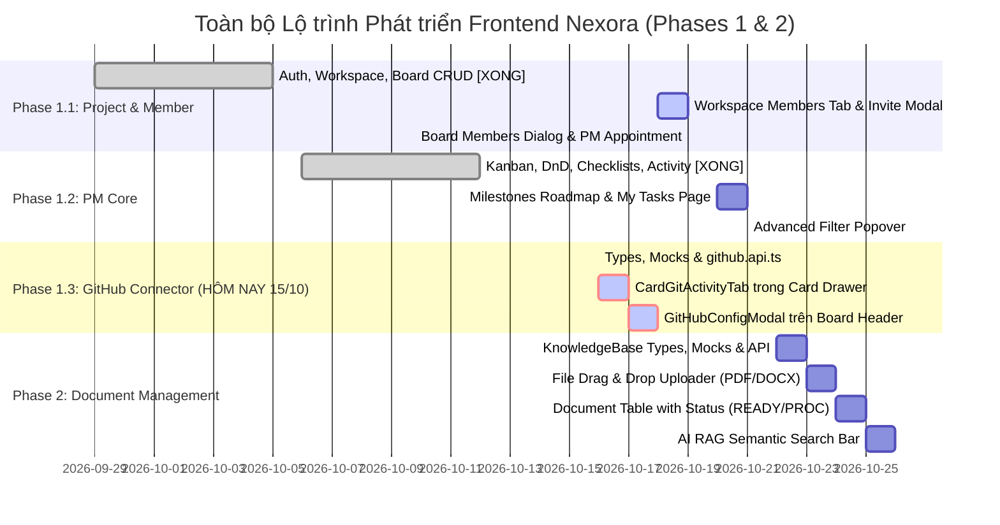

# KẾ HOẠCH HÀNH ĐỘNG FRONTEND TOÀN DIỆN — TẤT CẢ CÁC GIAI ĐOẠN (PHASES 1 & 2)

> **Dành riêng cho:** Frontend Engineer  
> **Dự án:** Nexora — Hệ thống Quản lý Dự án Đa lĩnh vực Tích hợp AI Agent  
> **Repository:** `d:\Document\TÀI LIỆU ĐỒ ÁN 1\Nexora\Frontend`  
> **Ngày lập kế hoạch:** 15/10/2026  
> **Mục tiêu:** Bản đặc tả chi tiết toàn bộ các đầu việc Frontend cần triển khai trên tất cả các giai đoạn (từ quá khứ cần bù đắp, giai đoạn hiện tại, đến giai đoạn sắp tới), loại bỏ mọi màn hình placeholder *"Under development"*, bảo đảm codebase sạch sẽ, type-safe và sẵn sàng nghiệm thu.

---

## MỤC LỤC TỔNG QUAN

1. [Bản đồ Tiến độ Tổng thể Frontend (Tất cả 4 Giai đoạn)](#1-bản-đồ-tiến-độ-tổng-thể-frontend-tất-cả-4-giai-đoạn)
2. [Giai đoạn 1.1: Lõi Quản lý Dự án (29/09 – 05/10/2026)](#2-giai-đoạn-11-lõi-quản-lý-dự-án-2909--05102026)
   - [2.1. Hiện trạng đã làm được](#21-hiện-trạng-đã-làm-được)
   - [2.2. Danh sách công việc Frontend CẦN LÀM](#22-danh-sách-công-việc-frontend-cần-làm)
3. [Giai đoạn 1.2: Project Management Core (06/10 – 12/10/2026)](#3-giai-đoạn-12-project-management-core-0610--12102026)
   - [3.1. Hiện trạng đã làm được](#31-hiện-trạng-đã-làm-được)
   - [3.2. Danh sách công việc Frontend CẦN LÀM](#32-danh-sách-công-việc-frontend-cần-làm)
4. [Giai đoạn 1.3: Tích hợp GitHub Connector (13/10 – 19/10/2026 — ĐANG DIỄN RA)](#4-giai-đoạn-13-tích-hợp-github-connector-1310--19102026--đang-diễn-ra)
   - [4.1. Hiện trạng thực tế](#41-hiện-trạng-thực-tế)
   - [4.2. Danh sách công việc Frontend CẦN LÀM (P0 — Khẩn cấp)](#42-danh-sách-công-việc-frontend-cần-làm-p0--khẩn-cấp)
5. [Giai đoạn 2: Phát triển Kho Tài liệu & Xử lý Nền (20/10 – 26/10/2026 — SẮP TỚI)](#5-giai-đoạn-2-phát-triển-kho-tài-liệu--xử-lý-nền-2010--26102026--sắp-tới)
   - [5.1. Hiện trạng thực tế](#51-hiện-trạng-thực-tế)
   - [5.2. Danh sách công việc Frontend CẦN LÀM](#52-danh-sách-công-việc-frontend-cần-làm)
6. [Bảng Ma trận Công việc Toàn diện & Mức độ Ưu tiên](#6-bảng-ma-trận-công-việc-toàn-diện--mức-độ-ưu-tiên)
7. [Lộ trình Triển khai Đề xuất (Execution Roadmap)](#7-lộ-trình-triển-khai-đề-xuất-execution-roadmap)

---

## 1. BẢN ĐỒ TIẾN ĐỘ TỔNG THỂ FRONTEND (TẤT CẢ 4 GIAI ĐOẠN)



---

## 2. GIAI ĐOẠN 1.1: LÕI QUẢN LÝ DỰ ÁN (29/09 – 05/10/2026)
> **Mục tiêu giai đoạn:** Triển khai authentication, project (workspace/board), member, role/permission.

### 2.1. Hiện trạng đã làm được
- **Xác thực người dùng (Authentication):**
  - Màn hình Đăng nhập (`LoginPage.tsx`), Đăng ký (`RegisterPage.tsx`), Quên mật khẩu (`ForgotPasswordPage.tsx`), Đặt lại mật khẩu (`ResetPasswordPage.tsx`), Xác thực email qua link OTP (`VerifyEmailPage.tsx`), Tiếp nhận Google OAuth (`OAuthCallbackPage.tsx`).
  - Lưu trữ JWT session an toàn trong Zustand store (`auth.store.ts`), cơ chế tự động refresh token trong `client.ts`.
- **Dự án cấp Workspace & Board:**
  - Danh sách Board theo Workspace (`BoardsPage.tsx`).
  - Tạo mới Workspace (`CreateWorkspaceModal.tsx`), Archive và Restore Workspace.
  - Tạo mới Board (`CreateBoardModal.tsx`), Archive, Restore và Xóa vĩnh viễn có xác nhận (`ConfirmDeleteBoardDialog.tsx`).
  - Điều hướng động `/boards/:boardId` sang màn hình Kanban chi tiết.

### 2.2. Danh sách công việc Frontend CẦN LÀM (Các phần còn thiếu):

#### 🔹 Task FE-101: Xây dựng Giao diện Quản lý Thành viên Workspace (`WorkspaceMembersTab.tsx`)
- **Vị trí:** Thay thế khối code placeholder tại dòng 303-312 của `BoardsPage.tsx` khi `activeTab === "members"`.
- **Thực trạng hiện tại:** Đang hiển thị *"Members Tab — This section is currently under development. Please check back soon."*
- **Yêu cầu triển khai:**
  - Gọi `workspaceApi.listWorkspaceMembers(workspaceId)` để tải danh sách thành viên.
  - **Bảng thành viên:**
    - Cột 1: Thành viên (Avatar chữ cái hoa, Tên đầy đủ, Email).
    - Cột 2: Vai trò trong Workspace (Badge `OWNER` màu tím/xanh đậm hoặc `MEMBER` màu xám trung tính).
    - Cột 3: Ngày gia nhập Workspace.
    - Cột 4: Thao tác (Menu 3 chấm): Tùy chọn xóa thành viên khỏi Workspace (`removeMember`) chỉ hiển thị với Owner.
  - **Khu vực Lời mời đang chờ (Pending Invitations):**
    - Liệt kê các email đã được mời nhưng chưa chấp nhận, kèm thời hạn hết hạn (TTL 7 ngày) và nút `Hủy lời mời` (`cancelInvitation`).
  - **Nút hành động chính:** Nút `+ Invite Members` mở `InviteMemberModal`.

#### 🔹 Task FE-102: Xây dựng Modal Mời Thành viên Workspace (`InviteMemberModal.tsx`)
- **Tệp tạo mới:** `src/components/workspace/InviteMemberModal.tsx`
- **Yêu cầu triển khai:**
  - Hộp thoại Radix Dialog: Ô nhập email hợp lệ (`type="email"`), dropdown chọn vai trò (`MEMBER`).
  - Nút bấm `Gửi lời mời` kèm loading spinner và toast alert qua `sonner`.
  - Kết nối phương thức `workspaceApi.inviteMember(workspaceId, email, role)`.

#### 🔹 Task FE-103: Xây dựng Trang Tiếp nhận Lời mời Workspace (`AcceptInvitationPage.tsx`)
- **Tệp tạo mới:** `src/pages/auth/AcceptInvitationPage.tsx`
- **Route khai báo:** `/workspace-invitations` (tiếp nhận query param `?token=...`).
- **Yêu cầu triển khai:**
  - Màn hình xác nhận lời mời: Hiển thị tên Workspace được mời tham gia.
  - 2 nút bấm: `Chấp nhận lời mời` (`acceptInvitation`) và `Từ chối` (`rejectInvitation`).
  - Khi chấp nhận thành công: Chuyển hướng người dùng về trang chủ của Workspace đó.

#### 🔹 Task FE-104: Xây dựng Dialog Quản lý Thành viên Board (`BoardMembersDialog.tsx`)
- **Tệp tạo mới:** `src/components/kanban/BoardMembersDialog.tsx`
- **Vị trí tích hợp:** Nâng cấp nút `+ Share / Members` trên `BoardDetailHeader.tsx` (hiện tại chỉ copy link vào clipboard).
- **Yêu cầu triển khai:**
  - Hiển thị danh sách thành viên đang có trong Board kèm vai trò:
    - `PM` (Project Manager): Badge xanh nổi bật.
    - `Member`: Badge thường.
  - Nút chuyển giao / Bổ nhiệm PM (`Make PM`): Chỉ Workspace Owner mới có quyền chuyển PM cho thành viên khác (gọi `boardApi.assignBoardPm`).
  - Dropdown thêm thành viên mới từ danh sách thành viên Workspace vào Board (`boardApi.addBoardMember`).
  - Nút gỡ thành viên khỏi Board (`boardApi.removeBoardMember`).
  - Giữ lại khung ô input URL kèm nút `Copy Board Link` để tiện chia sẻ.

#### 🔹 Task FE-105: Bổ sung các phương thức còn thiếu trong `workspace.api.ts`
- **Tệp cập nhật:** `src/apis/workspace.api.ts`
- **Các hàm cần thêm:**
  - `inviteWorkspaceMember(workspaceId, email, role)` ➔ `POST /workspaces/:id/invitations`
  - `removeWorkspaceMember(workspaceId, userId)` ➔ `DELETE /workspaces/:id/members/:userId`
  - `leaveWorkspace(workspaceId)` ➔ `POST /workspaces/:id/leave`
  - `listWorkspaceInvitations(workspaceId)` ➔ `GET /workspaces/:id/invitations`
  - `cancelWorkspaceInvitation(workspaceId, invitationId)` ➔ `DELETE /workspaces/:id/invitations/:id`

---

## 3. GIAI ĐOẠN 1.2: PROJECT MANAGEMENT CORE (06/10 – 12/10/2026)
> **Mục tiêu giai đoạn:** Triển khai task, milestone/phase, dependency, comment/activity và dashboard cơ bản.

### 3.1. Hiện trạng đã làm được (Rất hoàn chỉnh)
- **Kanban Core:** Kéo thả thẻ và cột bằng `@dnd-kit`, thêm thẻ nhanh, thêm cột nhanh, sửa chi tiết thẻ bài qua Drawer.
- **Checklists (Tasks):** Tạo danh sách checklist con (tối đa 50 tasks), checkbox hoàn thành, thanh tiến độ %.
- **Phân công & Nhãn:** Gán/gỡ thành viên, gắn/gỡ nhãn màu trên thẻ bài.
- **Dependencies (Phụ thuộc):** Thêm thẻ tiên quyết, kiểm tra chu trình DFS (`wouldCreateCycle`), cảnh báo xung đột lịch.
- **Comments & Activity:** Bình luận (OCC, @mention), lịch sử hoạt động phân trang cursor.
- **Dashboard Tiến độ:** `PlanningDashboardMetrics.tsx` (Tổng số, Todo, InProgress, Done, Overdue, Tỷ lệ hoàn thành).

### 3.2. Danh sách công việc Frontend CẦN LÀM:

#### 🔹 Task FE-201: Xây dựng Giao diện Quản lý Mốc Giai đoạn (Milestones / Roadmap View)
- **Vấn đề cần giải quyết:** Hiện tại Frontend chưa có màn hình trực quan riêng cho Milestones. Đề cương đồ án yêu cầu quản lý milestone/phase.
- **Giải pháp Frontend:** Thêm tab chế độ xem **"Roadmap / Milestones"** trong `BoardPlanningView.tsx` hoặc mở rộng View Switcher trên `BoardDetailToolbar.tsx`:
  - Cho phép người dùng tạo các Mốc (Milestone: Tên giai đoạn, Ngày bắt đầu, Hạn hoàn thành, Mô tả).
  - Phân nhóm các thẻ bài vào từng Mốc tương ứng.
  - Thanh tiến độ hoàn thành của từng Mốc (% số thẻ đã chuyển sang cột DONE thuộc Mốc đó).
  - Trực quan hóa tiến trình theo trục thời gian tuyến tính (Timeline bar).

#### 🔹 Task FE-202: Xây dựng Trang "Nhiệm vụ của Tôi" (`MyTasksPage.tsx`)
- **Vị trí:** Thay thế `<UnderDevelopmentPage />` tại route `ROUTES.MY_TASKS` ("/my-tasks").
- **Yêu cầu triển khai:**
  - Màn hình tập trung hiển thị tất cả các thẻ bài được phân công cho người dùng hiện tại trên toàn bộ các Board.
  - Bộ lọc 3 tab: `To Do` (Chưa làm), `In Progress` (Đang làm), `Done` (Đã hoàn tất).
  - Hiển thị ngày hạn chót, cờ cảnh báo quá hạn (`Overdue`) màu đỏ.
  - Click vào thẻ mở nhanh chi tiết thẻ hoặc chuyển hướng đến đúng Board tương ứng.

#### 🔹 Task FE-203: Xây dựng Trang Lịch Toàn cục Workspace (`GlobalCalendarPage.tsx`)
- **Vị trí:** Thay thế `<UnderDevelopmentPage />` tại route `ROUTES.CALENDAR` ("/calendar").
- **Yêu cầu triển khai:**
  - Tái sử dụng engine lịch từ `BoardCalendar.tsx`, mở rộng để hiển thị các đầu việc có ngày hạn từ tất cả các Board trong Workspace.
  - Cho phép lọc theo Board.

#### 🔹 Task FE-204: Xây dựng Bộ lọc Nâng cao cho Bảng Kanban (`CardFilterPopover.tsx`)
- **Vị trí:** Gắn vào nút `Filter` trên `BoardDetailToolbar.tsx` (hiện tại nút Filter chỉ hiển thị toast thông báo).
- **Yêu cầu triển khai:**
  - Popover dropdown cho phép lọc kết hợp:
    - Lọc theo Thành viên được giao (Assignees multi-select).
    - Lọc theo Nhãn (Labels multi-select).
    - Lọc theo Mức độ ưu tiên (Low, Medium, High, Urgent).
    - Lọc các thẻ Quá hạn (Only overdue cards).
  - Nút `Reset Filters` để xóa toàn bộ điều kiện lọc.

---

## 4. GIAI ĐOẠN 1.3: TÍCH HỢP GITHUB CONNECTOR (13/10 – 19/10/2026 — ĐANG DIỄN RA)
> **Mục tiêu giai đoạn:** Triển khai GitHub connector ở mức proof-of-concept và tích hợp dữ liệu với Agent khi cần.  
> **Thời điểm:** Hôm nay là 15/10/2026 — **Hạn chót: 19/10/2026 (Còn 4 ngày)**.

### 4.1. Hiện trạng thực tế
- **Frontend hiện tại: 0%** (Chưa có bất kỳ dòng code nào về GitHub Connector).
- Hợp đồng OpenAPI đã có sẵn tại `Backend/be/docs/api/openapi/github.yaml`.

### 4.2. Danh sách công việc Frontend CẦN LÀM (P0 — Khẩn cấp):

#### 🔹 Task FE-301: Khởi tạo Types & DTOs cho GitHub (`src/types/github.ts`)
- Định nghĩa các interface:
  - `GitHubConfig` (boardId, repositoryName, webhookUrl, isActive).
  - `GitHubConfigRequest` (repositoryName, webhookSecret).
  - `GitActivityItem` (id, cardId, type: COMMIT / PULL_REQUEST, identifier, message, author, authorAvatarUrl, url, timestamp).

#### 🔹 Task FE-302: Tạo Mock Fixtures cho GitHub (`src/mocks/data/github.mock.ts`)
- Tạo mock dữ liệu cho commits và pull requests gắn với các thẻ bài mẫu (`NEX-101`, `NEX-104`, `CARD-001`).
- Giúp Frontend phát triển giao diện và chạy tests độc lập ngay cả khi Backend chưa hoàn thiện webhook server.

#### 🔹 Task FE-303: Xây dựng API Client Layer (`src/apis/github.api.ts`)
- Viết 4 phương thức kết nối chuẩn OpenAPI:
  - `getGitHubConfig(boardId)` ➔ `GET /boards/:id/github/config`
  - `configureGitHub(boardId, payload)` ➔ `POST /boards/:id/github/config`
  - `disconnectGitHub(boardId)` ➔ `DELETE /boards/:id/github/config`
  - `getCardGitActivity(cardId)` ➔ `GET /cards/:id/git-activity` (có fallback mock data).

#### 🔹 Task FE-304: Xây dựng Modal Cấu hình GitHub trên Board (`GitHubConfigModal.tsx`)
- **Tệp tạo mới:** `src/components/kanban/GitHubConfigModal.tsx`
- **Vị trí tích hợp:** Menu Cài đặt Board (`BoardDetailHeader.tsx`).
- **Giao diện:**
  - Ô nhập Tên Repository GitHub (`owner/repo`).
  - Ô nhập Webhook Secret Key.
  - Ô hiển thị Payload Webhook URL (`http://localhost:3000/api/v1/github/webhooks`) kèm nút **Copy Webhook URL**.
  - Badge trạng thái `● Connected` và nút `Disconnect`.

#### 🔹 Task FE-305: Xây dựng Tab "Git Activity" trong Chi tiết Thẻ (`CardGitActivityTab.tsx`)
- **Tệp tạo mới:** `src/components/kanban/detail/activity/CardGitActivityTab.tsx`
- **Vị trí tích hợp:** Thêm tab thứ 3 `Code / Git` trong `CardDetailDrawer.tsx` (bên cạnh `Comments` và `Activity`).
- **Giao diện:**
  - Hiển thị danh sách các commit có nhắc đến mã thẻ (ví dụ commit message chứa `#NEX-101`).
  - Mỗi dòng commit gồm: Icon commit, Commit message, mã commit short SHA (badge font mono click mở tab mới sang GitHub), tên author git, thời gian commit.
  - Empty state hướng dẫn lập trình viên thêm cú pháp `#NEX-xxx` vào commit message khi push code.

---

## 5. GIAI ĐOẠN 2: PHÁT TRIỂN KHO TÀI LIỆU & XỬ LÝ NỀN (20/10 – 26/10/2026 — SẮP TỚI)
> **Mục tiêu giai đoạn:** Triển khai upload/quản lý tài liệu và background processing.

### 5.1. Hiện trạng thực tế
- **Frontend hiện tại:** Route `ROUTES.KNOWLEDGE_BASE` ("/knowledge-base") đang gắn vào `<UnderDevelopmentPage />`.
- Đã có đặc tả OpenAPI đầy đủ tại `Backend/be/docs/api/openapi/knowledge-base.yaml`.
- Đã có Cloudflare R2 / S3 adapter cho Card Attachments, nhưng tài liệu dự án Knowledge Base là phân hệ riêng phục vụ AI RAG.

### 5.2. Danh sách công việc Frontend CẦN LÀM:

#### 🔹 Task FE-401: Khởi tạo Types & DTOs cho Tài liệu (`src/types/document.ts`)
- Định nghĩa interface tài liệu:
  ```typescript
  export type DocumentStatus = "PENDING" | "PROCESSING" | "READY" | "FAILED";

  export interface KnowledgeBaseDocument {
    id: string;
    boardId: string;
    fileName: string;
    fileUrl: string;
    fileSize: number;
    status: DocumentStatus;
    uploadedBy: string;
    createdAt: string;
    updatedAt: string;
  }

  export interface RAGCitation {
    documentId: string;
    documentName: string;
    pageNumber?: number;
    snippet: string;
  }

  export interface RAGAnswer {
    answer: string;
    citations: RAGCitation[];
  }
  ```

#### 🔹 Task FE-402: Xây dựng API Client Tài liệu (`src/apis/knowledge-base.api.ts`)
- Các phương thức kết nối:
  - `uploadDocument(boardId: string, file: File): Promise<KnowledgeBaseDocument>`
    - Gửi request `multipart/form-data` lên `POST /api/v1/boards/:id/documents` (nhận mã 202 Accepted).
  - `listDocuments(boardId: string): Promise<KnowledgeBaseDocument[]>`
    - `GET /api/v1/boards/:id/documents`
  - `downloadDocument(documentId: string): Promise<string>`
    - `GET /api/v1/documents/:id/download`
  - `deleteDocument(documentId: string): Promise<void>`
    - `DELETE /api/v1/documents/:id`
  - `queryRAG(boardId: string, question: string): Promise<RAGAnswer>`
    - `POST /api/v1/boards/:id/rag/query`

#### 🔹 Task FE-403: Xây dựng Trang Kho Tài Liệu (`KnowledgeBasePage.tsx`)
- **Tệp tạo mới:** `src/pages/knowledge-base/KnowledgeBasePage.tsx`
- **Route kết nối:** Mở khóa `ROUTES.KNOWLEDGE_BASE` trong `src/routes.tsx`.
- **Thành phần giao diện:**
  1. **Khu vực Kéo-thả Tải lên (Dropzone Uploader):**
     - Cho phép kéo thả hoặc click chọn file (hỗ trợ `.pdf`, `.docx`, `.txt`, giới hạn 15MB).
     - Thanh hiển thị tiến độ tải lên (Upload Progress %).
  2. **Bảng Danh sách Tài liệu Dự án:**
     - Tên tệp kèm icon loại file (PDF đỏ, Word xanh lam, Text xám).
     - Dung lượng tệp (formatted dạng KB, MB).
     - Ngày tải lên và người tải lên.
     - **Badge Trạng thái Xử lý Nền (Background Processing Status):**
       - `PENDING`: Badge vàng (Đang xếp hàng chờ xử lý).
       - `PROCESSING`: Badge xanh dương có hiệu ứng quay `Loader2` (Đang bóc tách văn bản & sinh vector embeddings).
       - `READY`: Badge xanh lá (Đã xử lý xong, sẵn sàng phục vụ AI Agent).
       - `FAILED`: Badge đỏ (Lỗi xử lý) kèm nút "Thử lại".
     - Nút tải về tệp gốc và nút xóa tài liệu (kèm hộp thoại xác nhận).
  3. **Cơ chế Tự động Polling / Cập nhật Trạng thái:**
     - Khi có tệp đang ở trạng thái `PROCESSING`, tự động gọi lại API sau mỗi 3-5 giây cho đến khi chuyển sang `READY` hoặc `FAILED`.

#### 🔹 Task FE-404: Xây dựng Khung Tìm kiếm Ngữ nghĩa RAG (`DocumentSemanticSearchBar.tsx`)
- **Tệp tạo mới:** `src/components/knowledge-base/DocumentSemanticSearchBar.tsx`
- **Giao diện:**
  - Ô nhập câu hỏi tra cứu kiến thức dự án (ví dụ: *"Yêu cầu kỹ thuật về bảo mật của dự án là gì?"*).
  - Hộp kết quả: Hiển thị câu trả lời tổng hợp từ AI kèm các thẻ trích dẫn nguồn (`RAGCitation`: Tên file, số trang, đoạn văn trích dẫn).

---

## 6. BẢNG MA TRẬN CÔNG VIỆC TOÀN DIỆN & MỨC ĐỘ ƯU TIÊN

| Mã Task | Tên công việc Frontend | Thuộc Phase | Mức ưu tiên | Độ phức tạp | Tệp cần tạo / chỉnh sửa |
|---|---|---|---|---|---|
| **FE-301** | Định nghĩa Types/DTOs GitHub | Phase 1 (13/10 - 19/10) | **P0 (Làm ngay)** | **S** | `src/types/github.ts` |
| **FE-302** | Tạo Mock data Git activity | Phase 1 (13/10 - 19/10) | **P0 (Làm ngay)** | **S** | `src/mocks/data/github.mock.ts` |
| **FE-303** | Viết `src/apis/github.api.ts` | Phase 1 (13/10 - 19/10) | **P0 (Làm ngay)** | **S** | `src/apis/github.api.ts` |
| **FE-304** | Modal Cấu hình GitHub trên Board | Phase 1 (13/10 - 19/10) | **P0 (Làm ngay)** | **M** | `src/components/kanban/GitHubConfigModal.tsx` |
| **FE-305** | Tab "Git Activity" trong Card Drawer | Phase 1 (13/10 - 19/10) | **P0 (Làm ngay)** | **M** | `src/components/kanban/detail/activity/CardGitActivityTab.tsx` |
| **FE-101** | Component Tab Thành viên Workspace | Phase 1 (29/09 - 05/10) | **P1 (Quan trọng)** | **M** | `src/components/workspace/WorkspaceMembersTab.tsx` |
| **FE-102** | Modal Mời Thành viên Workspace | Phase 1 (29/09 - 05/10) | **P1 (Quan trọng)** | **S** | `src/components/workspace/InviteMemberModal.tsx` |
| **FE-104** | Dialog Quản lý Thành viên Board | Phase 1 (29/09 - 05/10) | **P1 (Quan trọng)** | **M** | `src/components/kanban/BoardMembersDialog.tsx` |
| **FE-105** | Bổ sung hàm Member vào `workspace.api.ts`| Phase 1 (29/09 - 05/10) | **P1 (Quan trọng)** | **S** | `src/apis/workspace.api.ts` |
| **FE-401** | Định nghĩa Types/DTOs Tài liệu KnowledgeBase | Phase 2 (20/10 - 26/10) | **P2 (Tuần tới)** | **S** | `src/types/document.ts` |
| **FE-402** | Viết `src/apis/knowledge-base.api.ts` | Phase 2 (20/10 - 26/10) | **P2 (Tuần tới)** | **M** | `src/apis/knowledge-base.api.ts` |
| **FE-403** | Trang Quản lý Kho Tài liệu & Background Status| Phase 2 (20/10 - 26/10) | **P2 (Tuần tới)** | **L** | `src/pages/knowledge-base/KnowledgeBasePage.tsx` |
| **FE-404** | Khung Tìm kiếm Ngữ nghĩa RAG Citations | Phase 2 (20/10 - 26/10) | **P2 (Tuần tới)** | **M** | `src/components/knowledge-base/DocumentSemanticSearchBar.tsx` |
| **FE-201** | Chế độ xem Milestones / Roadmap View | Phase 1 (06/10 - 12/10) | **P2 (Bổ sung)** | **M** | `src/components/kanban/planning/BoardMilestonesView.tsx` |
| **FE-202** | Trang Nhiệm vụ của Tôi (`MyTasksPage`) | Phase 1 (06/10 - 12/10) | **P2 (Bổ sung)** | **M** | `src/pages/tasks/MyTasksPage.tsx` |
| **FE-204** | Popover Lọc nâng cao cho Kanban | Phase 1 (06/10 - 12/10) | **P3 (Hoàn thiện)** | **S** | `src/components/kanban/CardFilterPopover.tsx` |
| **FE-103** | Trang Chấp nhận Lời mời (`AcceptInvitation`) | Phase 1 (29/09 - 05/10) | **P3 (Hoàn thiện)** | **S** | `src/pages/auth/AcceptInvitationPage.tsx` |

---

## 7. LỘ TRÌNH TRIỂN KHAI ĐỀ XUẤT (EXECUTION ROADMAP)

Để đảm bảo bạn hoàn thành toàn bộ khối lượng công việc một cách bài bản mà không bị rối, hãy thực hiện theo 3 chặng sau:

### 🚀 Chặng 1: Hoàn tất Giai đoạn Hiện tại — GitHub Connector POC (16/10 – 17/10)
- *Mục tiêu:* Có sản phẩm demo hoàn chỉnh tích hợp GitHub trên giao diện.
- **Ngày 1 (16/10):**
  - Viết `src/types/github.ts` và `src/mocks/data/github.mock.ts`.
  - Viết `src/apis/github.api.ts`.
  - Xây dựng component `CardGitActivityTab.tsx` và gắn vào `CardDetailDrawer.tsx`.
- **Ngày 2 (17/10):**
  - Xây dựng `GitHubConfigModal.tsx` và gắn vào `BoardDetailHeader.tsx`.
  - Kiểm tra luồng copy Webhook URL, nhập repo và xem commit trên thẻ bài `NEX-101`.

### 🛡️ Chặng 2: Bù đắp & Khép lại Toàn bộ Phase 1 (18/10 – 19/10)
- *Mục tiêu:* Xóa bỏ toàn bộ chữ *"Under development"* ở Tab Members và nút Share.
- **Ngày 3 (18/10):**
  - Bổ sung các phương thức vào `workspace.api.ts`.
  - Xây dựng `WorkspaceMembersTab.tsx` thay thế placeholder trên `BoardsPage.tsx`.
  - Xây dựng `InviteMemberModal.tsx` để mời thành viên qua email.
- **Ngày 4 (19/10 — Deadline Phase 1):**
  - Xây dựng `BoardMembersDialog.tsx` để quản lý thành viên Board và chuyển quyền PM.
  - Chạy toàn bộ kiểm tra: `npm run typecheck`, `npm run lint`, `npm run test`, `npm run build`.

### 📚 Chặng 3: Khởi động & Triển khai Phase 2 Kho Tài Liệu (20/10 – 26/10)
- *Mục tiêu:* Xây dựng hoàn chỉnh trang Knowledge Base và theo dõi xử lý nền.
- **Ngày 5 - 6 (20/10 – 22/10):**
  - Tạo Types, Mocks và `knowledge-base.api.ts`.
  - Xây dựng giao diện trang `KnowledgeBasePage.tsx` với vùng kéo thả file uploader.
- **Ngày 7 - 8 (23/10 – 24/10):**
  - Xây dựng Bảng danh sách tài liệu với cơ chế cập nhật trạng thái nền (`PENDING` ➔ `PROCESSING` ➔ `READY` / `FAILED`).
- **Ngày 9 - 10 (25/10 – 26/10):**
  - Xây dựng khung tra cứu ngữ nghĩa RAG (`DocumentSemanticSearchBar.tsx`) hiển thị câu trả lời AI kèm trích dẫn nguồn.
  - Xây dựng trang `MyTasksPage.tsx` gom việc cá nhân và hoàn tất toàn bộ sản phẩm.
