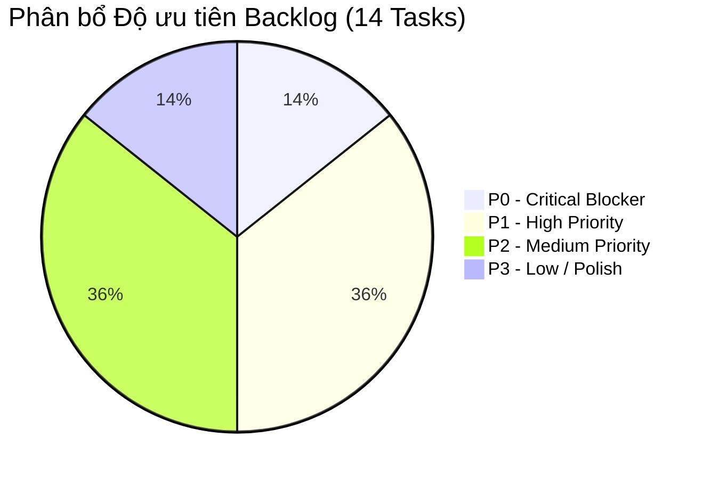
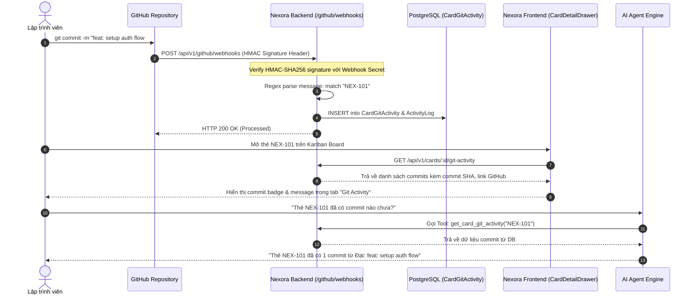

# BÁO CÁO ĐÁNH GIÁ THỰC TRẠNG TRIỂN KHAI VÀ ROADMAP THỰC THI DỰ ÁN NEXORA

> **Dự án:** Nexora — Hệ thống Quản lý Dự án Đa lĩnh vực Tích hợp AI Agent  
> **Repository:** `d:\Document\TÀI LIỆU ĐỒ ÁN 1\Nexora`  
> **Frontend:** `Frontend/` (Branch `staging` — commit `87dee15`, 570/570 unit tests pass)  
> **Backend:** `Backend/be/` (Branch `staging`)  
> **Ngày lập báo cáo:** 15/10/2026  
> **Loại tài liệu:** Implementation Audit & Actionable Task Backlog (Báo cáo Độc lập & Khuyến nghị Kỹ thuật)  
> **Quy tắc an toàn:** Static Analysis & Contract Verification (Không sửa mã nguồn, không biến đổi cơ sở dữ liệu)

---

## MỤC LỤC

- [A. Executive Summary (Tóm tắt Thực trạng Dự án)](#a-executive-summary-tóm-tắt-thực-trạng-dự-án)
- [B. Phase Completion Matrix (Ma trận Hoàn thành Kế hoạch)](#b-phase-completion-matrix-ma-trận-hoàn-thành-kế-hoạch)
- [C. Remaining Task Backlog (Danh mục Công việc Còn lại)](#c-remaining-task-backlog-danh-mục-công-việc-còn-lại)
- [D. GitHub Connector POC Detailed Checklist (Checklist Triển khai GitHub POC)](#d-github-connector-poc-detailed-checklist-checklist-triển-khai-github-poc)
- [E. Document Management & Background Processing Readiness (Đánh giá Hạ tầng Quản lý Tài liệu)](#e-document-management--background-processing-readiness-đánh-giá-hạ-tầng-quản-lý-tài-liệu)
- [F. Core Domain Gaps & Technical Debt Follow-up (Theo dõi Khoảng trống Kỹ thuật Core Domain)](#f-core-domain-gaps--technical-debt-follow-up-theo-dõi-khoảng-trống-kỹ-thuật-core-domain)
- [G. Recommended Execution Order (Trình tự Thực hiện Tối ưu)](#g-recommended-execution-order-trình-tự-thực-hiện-tối-ưu)
- [H. Definition of Done & Quality Gates (Tiêu chuẩn Hoàn thành & Cổng Kiểm soát)](#h-definition-of-done--quality-gates-tiêu-chuẩn-hoàn-thành--cổng-kiểm-soát)
- [I. Risks & NOT VERIFIED Items (Rủi ro & Các Hạng mục Chưa Xác minh)](#i-risks--not-verified-items-rủi-ro--các-hạng-mục-chưa-xác-minh)

---

## A. EXECUTIVE SUMMARY (TÓM TẮT THỰC TRẠNG DỰ ÁN)

Tính đến ngày **15/10/2026**, dự án **Nexora** đang ở thời điểm giao thoa quan trọng giữa 3 giai đoạn phát triển theo kế hoạch của nhóm hai người (Bảo & Đạt):

```
       06/10/2026                12/10/2026         15/10/2026 (HÔM NAY)       19/10/2026                26/10/2026
           |                          |                      |                      |                          |
           +--------------------------+----------------------+----------------------+--------------------------+
           |  PHASE 1: PM CORE        |  PHASE 1: GITHUB POC |                      |  PHASE 2: DOCUMENT MGMT  |
           |  (Hạn chót: 12/10)       |  (13/10 - 19/10)     |                      |  (20/10 - 26/10)         |
           |  Trạng thái: 85%         |  Trạng thái: 0%      |                      |  Trạng thái: 15%         |
           |  (QUÁ HẠN 3 NGÀY)        |  (CHẬM TIẾN ĐỘ)      |                      |  (SẮP DIỄN RA)           |
```

### 1. Đánh giá chi tiết từng giai đoạn

#### Giai đoạn 1: Project Management Core (06/10/2026 – 12/10/2026, Phụ trách: Bảo)
- **Hạn chót ban đầu:** 12/10/2026 (Hiện đã quá hạn 3 ngày).
- **Mức độ hoàn thành thực tế:** **85%**.
- **Điểm sáng kỹ thuật:**
  - Kiến trúc phân lớp chuẩn mực giữa Frontend và Backend. Hệ thống quản trị giao dịch ACID (`runBoardTransaction`, `REPEATABLE READ`, `runSerializable`), cơ chế khóa chống xung đột tương tranh Optimistic Concurrency Control (OCC qua `updatedAt` đơn điệu tăng), thuật toán chống chu trình phụ thuộc (`canReachCard` qua DFS), và cơ chế chặn kéo thẻ sang cột `DONE` khi vướng thẻ tiên quyết (`assertCardCanEnterDone`) đã hoạt động chính xác trong mã nguồn Backend.
  - Phía Frontend, đợt refactor toàn diện (`refactor/frontend-codebase`) đã hoàn tất và được merge vào nhánh `staging` qua PR #5. Toàn bộ 570/570 unit tests pass, typecheck 0 lỗi, lint 0 cảnh báo, build production thành công. Đã loại bỏ hoàn toàn mock data leakage trong production API, tách nhỏ các component quá tải (`CardDetailDrawer`), đồng bộ DTO mappers.
- **Tồn tại và Khoảng cách (Gaps):**
  - **Khoảng cách về Milestone/Phase Management:** Trong kế hoạch có ghi nhận "Milestone/Phase management", tuy nhiên kiến trúc Backend (`Backend/be/docs/CORE/README.md:39`) đã đưa ra quyết định: *"Không tự bổ sung thực thể Milestone hoặc Phase khi chưa có yêu cầu và căn cứ phù hợp."* Hiện hệ thống chỉ quản lý tiến độ qua Danh sách (Lists), Thẻ (Cards), Ngày bắt đầu/Hạn chót (Dates) và Bảng Kế hoạch (Planning View). Cần có sự thống nhất về mặt học thuật và báo cáo để không bị đánh giá là thiếu tính năng so với đề cương.
  - **Lỗi Runtime cấp P0/P1 khi đính kèm file:** Lỗi HTTP Header không hỗ trợ tên file Unicode tiếng Việt có dấu (`BE-CD-001`) và nguy cơ crash 500 khi xác thực MIME extension (`BE-CD-002`).
  - **Thiếu API cập nhật hồ sơ cá nhân:** `PATCH /api/v1/auth/me` chưa được khai báo ở Backend (`BE-CD-003`), gây lỗi 404 khi người dùng lưu thông tin cá nhân.
  - **Hiệu năng Kanban Board:** `GET /api/v1/boards/:boardId/cards` chưa trả kèm thông tin tóm tắt về Assignees và Labels (`BE-CD-004`), khiến Frontend phải query lazy từng card hoặc thiếu dữ liệu hiển thị thẻ trên bảng.

#### Giai đoạn 1: GitHub Connector Integration (13/10/2026 – 19/10/2026, Phụ trách: Toàn đội)
- **Khoảng thời gian:** Đang diễn ra (13/10 – 19/10/2026). Hôm nay là 15/10/2026 (đã đi qua 50% thời gian).
- **Mức độ hoàn thành thực tế:** **0% (CHƯA TRIỂN KHAI)**.
- **Thực trạng báo động:**
  - Hợp đồng API OpenAPI đã được thiết kế đầy đủ tại `Backend/be/docs/api/openapi/github.yaml` (bao gồm cấu hình repository, tiếp nhận Webhook HMAC-SHA256, và truy vấn Git Activity theo thẻ).
  - Tuy nhiên, trong mã nguồn thực tế:
    - Thư mục Backend `Backend/be/src/modules/github/` hoàn toàn rỗng ngoại trừ `routes/index.ts` chỉ có `export const githubRouter = Router();`. Toàn bộ controller, service, repository, DTO chỉ là các file `.gitkeep`.
    - Cơ sở dữ liệu Prisma (`schema.prisma`) **chưa hề có bảng nào** dành cho GitHub configuration hay Git activity (chỉ có giá trị enum `OAuthProvider.GITHUB`).
    - Phía Frontend hoàn toàn chưa có API service (`github.api.ts`) hay giao diện cấu hình Webhook / hiển thị Git commits trên thẻ bài.
    - AI Agent module (`Backend/be/src/modules/ai/`) cũng hoàn toàn rỗng, chưa có bất kỳ Tool hook nào để đọc dữ liệu GitHub.
- **Đánh giá rủi ro:** **CRITICAL BLOCKER**. Nếu không tập trung dồn lực triển khai trong 4 ngày còn lại (15/10 - 19/10), nhóm sẽ thất bại trong việc bàn giao kết quả của giai đoạn này theo cam kết.

#### Giai đoạn 2: Document Management & Background Processing (20/10/2026 – 26/10/2026)
- **Thời gian dự kiến:** Sắp bắt đầu sau 5 ngày nữa.
- **Mức độ sẵn sàng hạ tầng:** **15%**.
- **Thực trạng kiến trúc:**
  - File Attachment của Card đã hoạt động trên Cloudflare R2 / S3. Tuy nhiên, hệ thống tài liệu dự án Knowledge Base (hỗ trợ PDF/DOCX/TXT để trích xuất văn bản và tìm kiếm ngữ nghĩa RAG) là một phân hệ độc lập hoàn toàn (`Backend/be/docs/CORE/README.md:52`).
  - Hàng đợi xử lý nền **BullMQ đã bị hoãn** theo quyết định ngày 07/10/2026 (`deferred-infrastructure.md`). Chưa có Redis Queue / Worker nào được cấu hình cho việc trích xuất văn bản (Apache Tika / pdf-parse).
  - PostgreSQL chưa được kích hoạt extension `pgvector` và chưa có bảng lưu trữ chunks / embeddings trong `schema.prisma`.
  - Cần sớm chuẩn bị kiến trúc và thư viện trước ngày 20/10/2026 để tránh lặp lại tình trạng trễ tiến độ như GitHub Connector.

---

## B. PHASE COMPLETION MATRIX (MA TRẬN HOÀN THÀNH KẾ HOẠCH)

| Phase | Hạng mục / Tính năng | Owner | Deadline | Trạng thái | Hiện trạng Frontend | Hiện trạng Backend | Mức độ xác minh | Khoảng cách & Rào cản (Gaps & Blockers) |
|---|---|---|---|---|---|---|---|---|
| **Phase 1** | **Task Management (Kanban Core)** | Bảo | 12/10/2026 | `PARTIAL` | Đầy đủ UI Kanban, Column, Card, Inline Add, Drag & Drop (@dnd-kit). 570 tests pass. | CRUD Board/List/Card, OCC (`updatedAt`), Position reindexing (step 1024). | **Integration Verified** | `GET /boards/:id/cards` thiếu `assigneeIds` & `labels`. Tìm kiếm Card hiện lọc ở client, chưa có server query filter. |
| **Phase 1** | **Checklists / Child Tasks** | Bảo | 12/10/2026 | `DONE` | `CardDetailChecklist.tsx`, progress bar, toggle, reorder, auto-delete. | Module `child-resources`, max 50 tasks, auto tính `taskProgress` (total, completed, percent). | **Integration Verified** | Không có gap lớn. Hoạt động ổn định. |
| **Phase 1** | **Card Assignments & Labels** | Bảo | 12/10/2026 | `DONE` | `CardDetailMetadata.tsx`, avatar selection, label chips, color tagging. | Quản lý bảng `CardAssignment`, `Label`, `CardLabel`. Tự động thu hồi phân công khi rời Workspace. | **Integration Verified** | Backend chưa có unique constraint cho Label name trên cùng một Board (`BE-CD-011`). |
| **Phase 1** | **Milestone / Phase Management** | Bảo | 12/10/2026 | `SCOPE GAP` | Hiển thị qua Kanban Lists (TODO/IN_PROGRESS/DONE), ngày Start/Due, và `BoardPlanningView.tsx`. | **Không có bảng hay API riêng cho Milestone/Phase** (`docs/CORE/README.md:39` khẳng định không thêm entity này). | **Static Design Only** | **Khoảng cách nghiệp vụ:** Kế hoạch ghi có Milestone/Phase nhưng kiến trúc quyết định không làm entity riêng. Cần chốt thống nhất văn bản. |
| **Phase 1** | **Card Dependencies** | Bảo | 12/10/2026 | `DONE` | `CardDetailDependencies.tsx`, kiểm tra chu trình DFS (`wouldCreateCycle`), cảnh báo xung đột lịch. | Endpoint `/cards/:id/dependencies`, kiểm tra chu trình `canReachCard`, chặn chuyển sang DONE nếu vướng blocker (`assertCardCanEnterDone`). | **Integration Verified** | Phân quyền PM/Owner thêm dependency đã được thực thi chuẩn xác. |
| **Phase 1** | **Comments & Activities** | Bảo | 12/10/2026 | `PARTIAL` | `CardCommentsTab.tsx` (OCC), `CardActivityTab.tsx` (cursor-based pagination). | CRUD Comments (soft-delete, @mention). Lịch sử `ActivityLog` phân trang cursor. | **Integration Verified** | `ActivityLog` thiếu thông tin User Profile của Actor (`BE-CD-005`). Mâu thuẫn phân trang cursor vs quy ước page/limit (`BE-CD-006`). |
| **Phase 1** | **Basic Dashboard / Planning View** | Bảo | 12/10/2026 | `DONE` | `PlanningDashboardMetrics.tsx` (Total, Todo, InProgress, Done, Overdue, Completion Rate) kèm fallback client. | `GET /api/v1/boards/:boardId/dashboard` trả về tổng hợp trạng thái các thẻ bài trong Board. | **Integration Verified** | Đã map tương thích các trường dữ liệu qua `board.mapper.ts`. |
| **Phase 1** | **GitHub Connector POC (Config & Webhooks)** | Toàn đội | 19/10/2026 | `NOT STARTED` | Chưa có UI cấu hình GitHub repo hay webhook. Chưa có `github.api.ts`. | Chỉ có spec OpenAPI `github.yaml`. Thư mục `modules/github` hoàn toàn rỗng. Chưa có bảng DB. | **Not Verified (0% Code)** | **CRITICAL DELAY:** Hôm nay 15/10 (đã trôi qua 50% thời gian), hoàn toàn chưa có code thực thi. |
| **Phase 1** | **GitHub Data Integration with Agent** | Toàn đội | 19/10/2026 | `NOT STARTED` | Chưa có giao diện chat với Agent truy vấn thông tin Git. | Module `ai` hoàn toàn rỗng. Chưa có tool gọi Git activity. | **Not Verified (0% Code)** | Phụ thuộc vào việc hoàn thành Backend GitHub Webhook trước. |
| **Phase 2** | **Document Upload & Storage** | Toàn đội | 26/10/2026 | `PARTIAL` | `CardDetailAttachments.tsx` hỗ trợ upload file vào thẻ. Chưa có trang Knowledge Base tổng quan. | Có Cloudflare R2 / S3 adapter cho Card Attachments. Chưa có model `Document` cho Knowledge Base. | **Partial Verified** | Cần phân định rõ giữa Card Attachment (lưu file thô) và Knowledge Base Document (phục vụ RAG). |
| **Phase 2** | **Background Processing & Vectorization** | Toàn đội | 26/10/2026 | `NOT STARTED` | Chưa có giao diện hiển thị trạng thái xử lý tài liệu (PENDING, PROCESSING, READY, FAILED). | BullMQ bị hoãn. Chưa có worker bóc tách văn bản. Chưa có extension `pgvector` và vector embeddings. | **Not Verified (0% Code)** | Cần giải pháp xử lý nền thay thế (Sync worker hoặc kích hoạt lại BullMQ cơ bản). |
| **Core Domain** | **User Profile Management** | Bảo/Đạt | 12/10/2026 | `PARTIAL` | Form chỉnh sửa Profile `profileApi.updateProfile` đã sẵn sàng. | Có `GET /auth/me`, **thiếu route `PATCH /api/v1/auth/me`** (`BE-CD-003`). | **Frontend Verified / Backend Gap** | Người dùng bấm "Lưu thay đổi" hồ sơ cá nhân nhận mã lỗi 404. |

---

## C. REMAINING TASK BACKLOG (DANH MỤC CÔNG VIỆC CÒN LẠI)

Dưới đây là danh sách toàn bộ các đầu việc cần thực thi, được sắp xếp theo mức độ ưu tiên từ P0 (Ngăn chặn nghiệm thu / Crash) đến P3 (Tối ưu hóa).



### Bảng Backlog Chi tiết

| Task ID | Domain | Tên công việc | Mô tả chi tiết kỹ thuật | Priority | Size | Owner | Tệp nguồn liên quan | Acceptance Criteria (Tiêu chí nghiệm thu) |
|---|---|---|---|---|---|---|---|---|
| **TSK-001** | Collab | Khắc phục lỗi Header Unicode khi Upload File (`BE-CD-001`) | Chuẩn hóa header upload tệp tiếng Việt có dấu. Bổ sung tiếp nhận header `x-file-name-b64` (Base64 chuỗi UTF-8) và fallback giải mã `decodeURIComponent` cho header `x-file-name`. | **P0** | **S** | Backend | `Backend/be/src/modules/collaboration/controllers/collaboration.controller.ts`<br>`Frontend/src/apis/card/card-attachment.api.ts` | Upload tệp `Báo cáo Đồ án 1 — Final.pdf` không bị lỗi byte trình duyệt, tên tệp lưu đúng tiếng Việt có dấu trong DB và khi tải về. |
| **TSK-002** | Collab | Khắc phục lỗi crash 500 khi Validate MIME Fallback (`BE-CD-002`) | Sửa `assertAllowedFilename` truy cập `MIME_EXTENSIONS[mimeType]` an toàn; cho phép fallback magic-byte sniffing khi client gửi generic `application/octet-stream`. | **P0** | **S** | Backend | `Backend/be/src/modules/collaboration/services/collaboration.service.ts` | Upload file có `Content-Type: application/octet-stream` không gây lỗi JavaScript TypeError crash 500 server. Trả về mã lỗi 400 nếu file không hợp lệ. |
| **TSK-003** | Auth | Bổ sung Endpoint Cập nhật Hồ sơ Cá nhân (`BE-CD-003`) | Viết controller, schema validation và route `PATCH /api/v1/auth/me` để cập nhật `fullName` và `avatarUrl` trong bảng `User`. | **P1** | **S** | Backend | `Backend/be/src/modules/auth/routes/index.ts`<br>`Backend/be/src/modules/auth/controllers/auth.controller.ts` | Gửi request `PATCH /api/v1/auth/me` với body `{ fullName: "Nguyễn Văn A" }` trả về 200 kèm UserProfile đã cập nhật. Frontend lưu hồ sơ thành công. |
| **TSK-004** | GitHub | Tạo Prisma Schema cho GitHub Connector POC | Thêm các model `BoardGitHubConfig` (boardId, repoName, webhookSecret, isActive) và `CardGitActivity` (id, cardId, type: COMMIT/PR, identifier, message, author, url, timestamp). Chạy migration. | **P1** | **M** | Backend | `Backend/be/prisma/schema.prisma` | Migration Prisma thành công, tạo đủ các bảng và quan hệ với `Board` và `Card`. |
| **TSK-005** | GitHub | Triển khai Backend REST API Cấu hình GitHub & Webhook Receiver | Xây dựng CRUD `/boards/:id/github/config`, xác thực chữ ký HMAC-SHA256 tại `POST /github/webhooks`, trích xuất mã thẻ (`CARD-xxx`, `NEX-xxx`), lưu `CardGitActivity` và tạo `ActivityLog`. | **P1** | **L** | Backend | `Backend/be/src/modules/github/` (controllers, services, routes) | Webhook payload giả lập từ GitHub được verify hợp lệ bằng Secret, commit chứa `NEX-101` tự động liên kết vào Card tương ứng. |
| **TSK-006** | GitHub | Xây dựng UI Cấu hình GitHub & Tab Git Activity trên Card Drawer | Tạo `github.api.ts`, thêm modal cấu hình repo/webhook trong Board Settings, và thêm tab "Git Activity" trong `CardDetailDrawer.tsx` hiển thị danh sách commit/PR liên kết. | **P1** | **M** | Frontend | `Frontend/src/apis/github.api.ts`<br>`Frontend/src/components/kanban/detail/activity/CardGitActivityTab.tsx` | Người dùng cấu hình được repo cho board; xem được các commit liên kết kèm tác giả, message và liên kết ngoài sang GitHub. |
| **TSK-007** | Card | Bổ sung Metadata tóm tắt vào `GET /api/v1/boards/:id/cards` (`BE-CD-004`) | Query batch gom `assigneeIds`, `labels`, `commentsCount`, `attachmentsCount` ngay trong câu lệnh lấy danh sách thẻ bài của Board để hiển thị trực tiếp lên bảng Kanban. | **P1** | **M** | Backend | `Backend/be/src/modules/cards/services/card.service.ts`<br>`Frontend/src/mappers/card.mapper.ts` | Gọi `GET /boards/:id/cards` trả về đủ avatar thành viên và nhãn màu trên bảng Kanban mà không cần gửi hàng chục request lazy-fetch. |
| **TSK-008** | Planning | Thống nhất và Tài liệu hóa Nghiệp vụ Milestone/Phase | Họp nhóm làm rõ: Hệ thống dùng Kanban Lists + Dates + Dependencies để quản lý giai đoạn (Phase) hay bắt buộc tạo thêm thực thể `Milestone` độc lập. Cập nhật tài liệu SRS/Architecture. | **P1** | **S** | Fullstack / Product | `docs/implementation-roadmap.md`<br>`Backend/be/docs/CORE/business-rules.md` | Có văn bản thống nhất chính thức giữa 2 thành viên về phương án hiển thị và trình bày với hội đồng nghiệm thu. |
| **TSK-009** | AI/GitHub | Tích hợp Dữ liệu GitHub vào AI Agent (Tool Hook) | Viết Tool calling function `get_card_git_activity` cho AI Agent cho phép Agent tra cứu các commit kỹ thuật của thẻ bài khi trả lời người dùng. | **P2** | **M** | Backend | `Backend/be/src/modules/ai/` | Hỏi Agent: "Đầu việc NEX-101 đã có code commit chưa?", Agent gọi tool và trả về mã commit thực tế. |
| **TSK-010** | Document | Thiết lập Hạ tầng Phase 2: Schema & Text Parsing cho Knowledge Base | Thêm model `KnowledgeBaseDocument` và `DocumentChunk` vào Prisma; cài đặt thư viện bóc tách file (`pdf-parse`, `mammoth`); chuẩn bị extension `pgvector`. | **P2** | **L** | Backend | `Backend/be/prisma/schema.prisma`<br>`Backend/be/src/modules/knowledge-base/` | Upload tài liệu PDF/DOCX trích xuất được nội dung text thô và phân chia chunks (khoảng 500-1000 tokens). |
| **TSK-011** | Collab | Bổ sung Thông tin Định danh Actor vào ActivityLog (`BE-CD-005`) | Bổ sung `include: { actor: { select: { id: true, fullName: true, avatarUrl: true } } }` vào câu query `listCardActivity` trong `collaboration.service.ts`. | **P2** | **S** | Backend | `Backend/be/src/modules/collaboration/services/collaboration.service.ts` | Lịch sử hoạt động luôn hiển thị đúng họ tên người thực hiện, kể cả khi thành viên đó đã rời khỏi Board/Workspace. |
| **TSK-012** | Card | Hỗ trợ Tham số Tìm kiếm & Lọc Card phía Server (`BE-CD-012`) | Bổ sung query params `?q=keyword&assigneeId=...&labelId=...&statusGroup=...` vào `GET /api/v1/boards/:id/cards` để lọc phía database. | **P2** | **M** | Backend | `Backend/be/src/modules/cards/services/card.service.ts` | Tìm kiếm thẻ bài hoạt động chính xác và hiệu năng cao khi Board đạt quy mô hàng trăm thẻ bài. |
| **TSK-013** | Label | Ràng buộc Chống Trùng lặp Tên Nhãn trong cùng Board (`BE-CD-011`) | Kiểm tra kiểm tra trùng lặp tên nhãn (case-insensitive trim) trong `createBoardLabel` trước khi tạo mới nhãn. | **P3** | **S** | Backend | `Backend/be/src/modules/cards/child-resources/service.ts` | Tạo nhãn trùng tên trên cùng một Board bị từ chối với mã lỗi 409 `LABEL_ALREADY_EXISTS`. |
| **TSK-014** | QuickNote| Xây dựng UI Widget Ghi chú Nhanh trên Frontend (`BE-CD-013`) | Viết `quick-note.api.ts` và component Drawer/Floating Widget cho phép người dùng ghi chép nhanh và 1-click chuyển note thành Kanban Card. | **P3** | **M** | Frontend | `Frontend/src/apis/quick-note.api.ts`<br>`Frontend/src/components/quick-notes/` | Người dùng tạo ghi chú cá nhân, xem danh sách và bấm "Convert to Card" chuyển thành thẻ trên bảng Kanban thành công. |

---

## D. GITHUB CONNECTOR POC DETAILED CHECKLIST (CHECKLIST TRIỂN KHAI GITHUB POC)

Do thời hạn hoàn thành GitHub Connector là ngày **19/10/2026** (chỉ còn 4 ngày làm việc), nhóm cần tập trung vào phạm vi Proof-of-Concept (POC) tối thiểu nhưng có thể demo được trực tiếp:



### Checklist Hành động Khẩn cấp cho Nhóm (15/10 – 19/10/2026):

#### 1. Cơ sở dữ liệu & Schema (Ngày 15/10)
- [ ] Thêm model `BoardGitHubConfig` vào `Backend/be/prisma/schema.prisma`:
  - `boardId` (UUID, Foreign Key tới `Board`, `@unique`)
  - `repositoryName` (String, ví dụ: `nexora-org/nexora-backend`)
  - `webhookSecret` (String, lưu mã bí mật HMAC)
  - `isActive` (Boolean, default `true`)
  - `createdAt`, `updatedAt`
- [ ] Thêm model `CardGitActivity` vào `Backend/be/prisma/schema.prisma`:
  - `id` (UUID, Primary Key)
  - `cardId` (UUID, Foreign Key tới `Card`)
  - `type` (Enum: `COMMIT`, `PULL_REQUEST`)
  - `identifier` (String, ví dụ: short SHA `a28b92a` hoặc PR `#12`)
  - `message` (String, tiêu đề commit/PR)
  - `author` (String, tên tác giả git)
  - `url` (String, link dẫn đến commit trên GitHub)
  - `timestamp` (DateTime)
- [ ] Chạy `npx prisma migrate dev --name init_github_connector_poc`.

#### 2. Backend REST Implementation (Ngày 16/10)
- [ ] Triển khai `github.service.ts`:
  - `configureBoardGitHub(boardId, repoName, secret)`: Lưu cấu hình cho Board (kiểm tra quyền Board PM/Owner).
  - `getBoardGitHubConfig(boardId)`: Lấy thông tin cấu hình (mặt nạ hóa secret `********`).
  - `disconnectBoardGitHub(boardId)`: Hủy liên kết repository.
- [ ] Triển khai Webhook Handler (`POST /api/v1/github/webhooks`):
  - Kiểm tra header `X-Hub-Signature-256`. Tính mã HMAC-SHA256 từ raw body và secret lưu trong DB để đối chiếu an toàn (`crypto.timingSafeEqual`).
  - Lắng nghe event `push`: Duyệt mảng `commits`, dùng Regex `/(NEX-\d+|CARD-\d+)/i` để tìm mã thẻ trong commit message.
  - Lắng nghe event `pull_request`: Kiểm tra tiêu đề và branch name để tìm mã thẻ.
  - Khi tìm thấy mã thẻ: Tìm `Card` tương ứng trong cùng Board liên kết; ghi bản ghi vào `CardGitActivity` và tạo 1 dòng nhật ký vào `ActivityLog`.
- [ ] Triển khai Endpoint Truy vấn:
  - `GET /api/v1/cards/:id/git-activity`: Trả về danh sách GitActivity của thẻ bài sắp xếp theo thời gian mới nhất.

#### 3. Frontend Client & UI Integration (Ngày 17/10)
- [ ] Tạo `Frontend/src/apis/github.api.ts`:
  - `getGitHubConfig(boardId)`
  - `configureGitHub(boardId, payload)`
  - `disconnectGitHub(boardId)`
  - `getCardGitActivity(cardId)`
- [ ] Thêm nút & modal cấu hình "GitHub Integration" trong `BoardDetailHeader.tsx` hoặc Options Menu.
- [ ] Thêm tab "Code / Git Activity" trong `CardDetailDrawer.tsx` (sử dụng icon `GitCommit` từ `lucide-react`):
  - Hiển thị danh sách commit: Commit message, commit short SHA dạng code chip, author name, thời gian, và liên kết ngoài mở GitHub.
  - Empty state: "Chưa có commit hoặc pull request nào nhắc đến mã thẻ này."

#### 4. Kịch bản Kiểm thử & Demo Proof-of-Concept (Ngày 18/10 – 19/10)
- [ ] Cài đặt công cụ `ngrok` hoặc `localtunnel` để public endpoint localhost của Backend:
  `ngrok http 3000` ➔ Lấy URL dạng `https://xxx.ngrok-free.app/api/v1/github/webhooks`.
- [ ] Cấu hình Webhook trên một Repository GitHub thật:
  - Payload URL: URL ngrok.
  - Content type: `application/json`.
  - Secret: Chuỗi bí mật đã nhập trên Nexora.
  - Events: `Just the push event` và `Pull requests`.
- [ ] Thực hiện commit thật trên repo: `git commit -m "fix(auth): fix password validation #CARD-001"` và push.
- [ ] Xác nhận trên giao diện Nexora: Mở thẻ `CARD-001`, thấy commit xuất hiện ngay lập tức trong tab Git Activity.
- [ ] Quay video màn hình hoặc chụp ảnh minh chứng đưa vào báo cáo nghiệm thu Phase 1.

---

## E. DOCUMENT MANAGEMENT & BACKGROUND PROCESSING READINESS (ĐÁNH GIÁ HẠ TẦNG QUẢN LÝ TÀI LIỆU)

Giai đoạn 2 (20/10/2026 – 26/10/2026) tập trung vào **Quản lý Tài liệu (Document Management)** và **Xử lý nền (Background Processing)**. Dưới đây là phân tích độ sẵn sàng kỹ thuật để chuẩn bị khởi động:

### 1. Phân biệt rõ ràng giữa hai luồng tệp tin
Cần nhấn mạnh nguyên tắc kiến trúc đã được định hình tại `Backend/be/docs/CORE/README.md:52`:
- **Luồng 1 — Card Attachments (Đã có sẵn):** Là tệp đính kèm phục vụ trao đổi nội bộ trong từng thẻ bài (ảnh minh họa lỗi, tệp log, mockup). Lưu trữ nhị phân trực tiếp trên Cloudflare R2 / S3. Không qua bóc tách văn bản hay nhúng vector.
- **Luồng 2 — Knowledge Base Documents (Phase 2):** Là các tài liệu đặc tả dự án cấp Board (SRS, thiết kế kiến trúc, tài liệu nghiệp vụ, API spec). Tệp tải lên (PDF, DOCX, TXT max 15MB) phải được đưa vào pipeline xử lý nền: trích xuất văn bản thô ➔ phân tách đoạn (chunking) ➔ sinh vector embedding ➔ lưu vào `pgvector` phục vụ tính năng RAG cho AI Agent.

### 2. Đánh giá Mức độ Sẵn sàng của các Khối Kiến trúc

```
+-----------------------------------+--------------------------------+----------------------------+
| Thành phần Kiến trúc              | Hiện trạng trong Repository    | Đánh giá Sẵn sàng          |
+-----------------------------------+--------------------------------+----------------------------+
| API Contract (OpenAPI Specification)| Đã định nghĩa đầy đủ tại       | SẴN SÀNG (100%)            |
|                                   | docs/api/openapi/              |                            |
|                                   | knowledge-base.yaml            |                            |
+-----------------------------------+--------------------------------+----------------------------+
| Object Storage (Cloudflare R2/S3) | Đã có S3 Adapter hoàn chỉnh,   | SẴN SÀNG (90%)             |
|                                   | có cơ chế PendingObjectCleanup | (Cần khắc phục encoding)   |
+-----------------------------------+--------------------------------+----------------------------+
| Prisma Database Schema            | CHƯA CÓ bảng Document hay      | CHƯA SẴN SÀNG (0%)         |
|                                   | DocumentChunk trong schema     |                            |
+-----------------------------------+--------------------------------+----------------------------+
| PostgreSQL pgvector Extension     | Chưa được kích hoạt trong DB   | CHƯA SẴN SÀNG (0%)         |
+-----------------------------------+--------------------------------+----------------------------+
| Background Job Queue (BullMQ)     | BỊ TẠM HOÃN theo văn bản       | THIẾU HẠ TẦNG              |
|                                   | deferred-infrastructure.md     | (Cần giải pháp thay thế)   |
+-----------------------------------+--------------------------------+----------------------------+
| Text Extraction Parser            | Chưa cài đặt pdf-parse hoặc    | CHƯA SẴN SÀNG (0%)         |
|                                   | thư viện bóc tách Word/Docx    |                            |
+-----------------------------------+--------------------------------+----------------------------+
```

### 3. Đề xuất Kỹ thuật cho Phase 2 (Khuyến nghị Thực tế cho Đồ án)

Do hạ tầng đồ án bị giới hạn thời gian và BullMQ đã bị hoãn:
1. **Phương án Xử lý Nền (Background Processing):**
   - *Lựa chọn A (Khuyến nghị cho Đồ án):* Sử dụng **In-Process Background Task** (Async Job Queue đơn giản trong bộ nhớ Node.js qua EventEmitter hoặc SetImmediate) nếu môi trường máy chủ nghiệm thu không thể cài đặt cụm Redis Worker độc lập. Khi client upload, API trả về `202 Accepted` ngay lập tức với status `PENDING`, tiến trình nền chạy ngầm và cập nhật trạng thái `READY` hoặc `FAILED` vào database.
   - *Lựa chọn B (Chuẩn SRS):* Khôi phục BullMQ với Redis container. Thích hợp nếu nhóm có sẵn Docker Compose Redis đang chạy ổn định.
2. **Kích hoạt Extension `pgvector`:**
   - Trong PostgreSQL migration: Thực thi câu lệnh `CREATE EXTENSION IF NOT EXISTS vector;`.
   - Trong Prisma schema: Định nghĩa bảng `DocumentChunk` với trường `embedding Unsupported("vector(1536)")`.
3. **Thư viện Parser gọn nhẹ:**
   - Thay vì cài đặt cả cụm Apache Tika cồng kềnh (cần Java Runtime), đề xuất sử dụng thư viện Node.js thuần: `pdf-parse` cho tệp PDF và `mammoth` cho tệp DOCX. Giải pháp này giúp quá trình cài đặt và demo đồ án mượt mà, không phụ thuộc vào hạ tầng Java bên ngoài.

---

## F. CORE DOMAIN GAPS & TECHNICAL DEBT FOLLOW-UP (THEO DÕI KHOẢNG TRỐNG KỸ THUẬT CORE DOMAIN)

Bảng tổng hợp theo dõi các vấn đề kỹ thuật đã được ghi nhận trong đợt audit trước (`BACKEND_CORE_DOMAIN_FEEDBACK.md`) và trạng thái cập nhật đến ngày 15/10/2026:

| Mã Gap | Mức độ | Mô tả tóm tắt | Trạng thái hiện tại | Ảnh hưởng đối với Frontend | Đề xuất giải pháp & Trách nhiệm |
|---|---|---|---|---|---|
| **BE-CD-001** | **P0** | Header `x-file-name` không hỗ trợ Unicode tiếng Việt khi upload file | `CONFIRMED_GAP` | Trình duyệt ném ngoại lệ byte; tên file tiếng Việt bị hỏng khi lưu/tải về. | Backend tiếp nhận `x-file-name-b64` (Base64) song song; Frontend gửi cả 2 headers. |
| **BE-CD-002** | **P1** | Lỗ hổng crash 500 khi validate MIME Fallback của Attachment | `CONFIRMED_GAP` | Request upload bị trả về 500 Internal Error thay vì báo lỗi thân thiện 400. | Backend sửa hàm `assertAllowedFilename`, kiểm tra an toàn `MIME_EXTENSIONS` và sniff magic-bytes. |
| **BE-CD-003** | **P1** | Thiếu endpoint cập nhật hồ sơ cá nhân `PATCH /api/v1/auth/me` | `CONFIRMED_GAP` | Frontend có sẵn form cập nhật nhưng gọi API bị lỗi 404 Route Not Found. | Backend khai báo route và controller cập nhật `User.fullName` và `avatarUrl`. |
| **BE-CD-004** | **P1** | `GET /boards/:id/cards` thiếu dữ liệu tóm tắt cho bảng Kanban | `PARTIAL` | Kanban không render được avatar thành viên và nhãn ngay lập tức nếu không lazy-fetch. | Backend bổ sung query gom `assigneeIds` và `labels` vào DTO trả về. |
| **BE-CD-005** | **P2** | `ActivityLog` response thiếu thông tin profile của Actor | `CONFIRMED_GAP` | Hiển thị người dùng vô danh ("User") trong lịch sử khi thành viên đã rời board. | Backend bổ sung `include: { actor: { select: { fullName, avatarUrl } } }`. |
| **BE-CD-006** | **P2** | Mâu thuẫn giao thức phân trang giữa Business Rules và Code | `NEEDS_DECISION` | Tài liệu ghi không dùng cursor, nhưng code Activity dùng cursor pagination. | Chốt quyết định chính thức: Giữ nguyên Cursor Pagination cho Activity Log & Notification; cập nhật tài liệu spec. |
| **BE-CD-007** | **P2** | Refresh Token vận chuyển qua JSON Body khác với HttpOnly Cookie trong SRS | `NEEDS_DECISION` | Đang chạy ổn định qua JSON body; SRS yêu cầu HttpOnly Cookie chống XSS. | Giữ nguyên JSON body cho giai đoạn đồ án (có giải trình kiến trúc), hoặc chuyển sang Cookie nếu bị bắt buộc. |
| **BE-CD-008** | **P2** | Lệch tên trường dữ liệu Planning Dashboard | `MITIGATED` | Tên trường Backend (`todo`, `done`) lệch với Frontend (`todoCards`, `completedCards`). | **Frontend đã giải quyết triệt để:** `mapBoardDashboardDtoToBoardDashboard` trong `board.mapper.ts` đã chuyển đổi tương thích 100%. |
| **BE-CD-009** | **P2** | Phân quyền tạo Board quá khắt khe (chỉ Owner) | `POTENTIAL_RISK` | Member trong Workspace bấm tạo Board bị lỗi 403 Forbidden. | Frontend kiểm tra `isWorkspaceOwner` để ẩn/disable nút "+ Create Board" đối với Member. |
| **BE-CD-010** | **P2** | Phân quyền xóa Card quá rộng rãi cho mọi Member | `POTENTIAL_RISK` | Bất kỳ thành viên nào cũng có quyền xóa vĩnh viễn thẻ của người khác. | Backend cân nhắc giới hạn quyền xóa cho PM/Owner hoặc người tạo thẻ. |
| **BE-CD-011** | **P3** | Cho phép tạo nhiều nhãn (Label) trùng tên trong cùng Board | `PARTIAL` | Gây nhầm lẫn khi người dùng gán nhãn vào thẻ bài. | Backend kiểm tra trùng lặp tên nhãn trước khi tạo mới. |
| **BE-CD-012** | **P2** | Thiếu endpoint tìm kiếm và lọc Card phía Server | `CONFIRMED_GAP` | Frontend đang phải tự filter mảng ở client; không tối ưu khi bảng có nhiều thẻ. | Backend hỗ trợ thêm query params tìm kiếm vào `GET /boards/:id/cards`. |
| **BE-CD-013** | **P3** | Module Quick Notes chưa có giao diện trên Frontend | `PARTIAL` | Backend đã xong 100% nhưng Frontend chưa có component UI để dùng. | Frontend bổ sung Floating Action Widget để tạo và convert Quick Note. |

---

## G. RECOMMENDED EXECUTION ORDER (TRÌNH TỰ THỰC HIỆN TỐI ƯU)

Để tối ưu hóa thời gian từ nay (15/10) đến khi kết thúc Phase 2 (26/10), đề xuất lộ trình triển khai gồm 4 đợt tập trung (Sprints):

```mermaid
graph TD
    subgraph "Sprint 1: Cứu vãn Tiến độ & Vá Lỗi Cốt lõi (15/10 - 17/10)"
        S1A["TSK-001 & TSK-002: Vá lỗi Attachment Unicode & MIME Crash"]
        S1B["TSK-003: Thêm PATCH /auth/me"]
        S1C["TSK-004 & TSK-005: Xây dựng Backend GitHub Webhook & DB Schema"]
        S1D["TSK-007: Thêm assignees & labels vào GET /cards"]
    end

    subgraph "Sprint 2: Hoàn tất & Nghiệm thu GitHub POC (18/10 - 19/10)"
        S2A["TSK-006: Hoàn thiện UI Cấu hình GitHub & Tab Git Activity"]
        S2B["TSK-009: Tool Hook tích hợp Git Activity cho AI Agent"]
        S2C["Test End-to-End với Webhook GitHub thật & Video Demo"]
    end

    subgraph "Sprint 3: Khởi động Phase 2 Quản lý Tài liệu (20/10 - 23/10)"
        S3A["TSK-010: Schema KnowledgeBaseDocument & Cài đặt Text Parsers"]
        S3B["Cấu hình pgvector & In-Process Background Worker"]
        S3C["API Upload Document (202 Accepted) & List Documents"]
        S3D["Giao diện Quản trị Tài liệu Dự án trên Frontend"]
    end

    subgraph "Sprint 4: RAG Semantic Search & Hoàn thiện Nợ Kỹ thuật (24/10 - 26/10)"
        S4A["Triển khai POST /rag/query với trích dẫn Citation"]
        S4B["TSK-011: Actor Profile trong ActivityLog"]
        S4C["TSK-014: UI Quick Notes trên Frontend"]
        S4D["Tổng kiểm thử Toàn diện & Đóng Kế hoạch Đồ án"]
    end

    Sprint 1 --> Sprint 2
    Sprint 2 --> Sprint 3
    Sprint 3 --> Sprint 4
```

### Chi tiết các mốc thực hiện:

- **Sprint 1 (15/10 – 17/10): Cứu vãn Tiến độ & Vá Lỗi Cốt lõi (Khẩn cấp)**
  - *Mục tiêu:* Khép lại các blocker của Phase 1 PM Core và dựng xong khung Backend cho GitHub Connector.
  - *Việc cần làm:*
    1. Sửa lỗi upload file Unicode tiếng Việt và MIME fallback (`TSK-001`, `TSK-002`).
    2. Bổ sung `PATCH /api/v1/auth/me` (`TSK-003`).
    3. Thêm model `BoardGitHubConfig` và `CardGitActivity` vào Prisma, chạy migration (`TSK-004`).
    4. Viết logic tiếp nhận Webhook GitHub HMAC và bóc tách mã thẻ (`TSK-005`).
    5. Cập nhật `GET /boards/:id/cards` trả kèm `assigneeIds` và `labels` (`TSK-007`).

- **Sprint 2 (18/10 – 19/10): Hoàn thiện & Nghiệm thu GitHub POC (Đúng hạn 19/10)**
  - *Mục tiêu:* Có sản phẩm demo hoàn chỉnh tích hợp giữa GitHub và Nexora.
  - *Việc cần làm:*
    1. Xây dựng Tab Git Activity trong `CardDetailDrawer` trên Frontend (`TSK-006`).
    2. Viết Tool hook cho AI Agent tra cứu commit (`TSK-009`).
    3. Chạy kiểm thử giả lập webhook và kết nối ngrok thực tế. Hoàn thành toàn bộ tiêu chí của Phase 1 GitHub Connector.

- **Sprint 3 (20/10 – 23/10): Khởi động Phase 2 Quản lý Tài liệu**
  - *Mục tiêu:* Vận hành luồng tải lên và xử lý tài liệu Knowledge Base.
  - *Việc cần làm:*
    1. Thiết lập schema tài liệu và cài đặt thư viện bóc tách văn bản `pdf-parse`/`mammoth` (`TSK-010`).
    2. Xây dựng endpoint upload tệp trả về mã 202 Accepted và tiến trình bóc tách chạy ngầm.
    3. Xây dựng giao diện trang Tài liệu Dự án trên Frontend hiển thị danh sách tài liệu và trạng thái xử lý (`PENDING` ➔ `PROCESSING` ➔ `READY`).

- **Sprint 4 (24/10 – 26/10): Tích hợp RAG Search & Đóng Nợ Kỹ thuật**
  - *Mục tiêu:* Bàn giao hoàn chỉnh Phase 2 Document Management và hoàn thiện đồ án.
  - *Việc cần làm:*
    1. Triển khai endpoint tìm kiếm ngữ nghĩa `/boards/:id/rag/query` trả về câu trả lời kèm trích dẫn nguồn.
    2. Bổ sung thông tin Actor cho ActivityLog (`TSK-011`).
    3. Bổ sung Widget Quick Notes (`TSK-014`).
    4. Chạy toàn bộ các bộ kiểm thử tự động, đóng mã nguồn và chuẩn bị báo cáo thuyết minh đồ án.

---

## H. DEFINITION OF DONE & QUALITY GATES (TIÊU CHUẨN HOÀN THÀNH & CỔNG KIỂM SOÁT)

Mỗi tính năng hoặc task trong backlog chỉ được đánh dấu là **DONE** khi và chỉ khi thỏa mãn đầy đủ các điều kiện khắt khe sau:

### 1. Hợp đồng & Kiến trúc (Contract & Architecture)
- Phải có định nghĩa schema trong OpenAPI specification (`Backend/be/docs/api/openapi/`).
- Các trường dữ liệu (naming convention) phải nhất quán giữa camelCase (JSON/TypeScript) và snake_case (PostgreSQL DB).
- Tách biệt rõ ràng giữa DTO (mạng truyền tải) và Domain Model (nội bộ ứng dụng). Mọi dữ liệu đi vào Frontend phải đi qua pure mapper function trong `src/mappers/`.

### 2. Tiêu chuẩn Mã nguồn Backend
- Mọi thao tác ghi dữ liệu phức hợp trên nhiều bảng phải được bọc trong database transaction (`runBoardTransaction` hoặc `runSerializable`).
- Thao tác cập nhật thực thể chia sẻ (Board, Card) bắt buộc phải kiểm tra xung đột tương tranh Optimistic Concurrency Control (OCC qua `updatedAt`).
- Bắt buộc kiểm tra phân quyền truy cập tập trung (`requireWorkspaceAccess`, `requireBoardAccess`), loại trừ triệt để lỗ hổng truy cập chéo dữ liệu (IDOR).
- Không được nuốt lỗi hoặc để sập tiến trình với mã lỗi 500 unhandled; mọi lỗi nghiệp vụ phải trả về mã `AppError` chuẩn hóa (400, 401, 403, 404, 409, 413).

### 3. Tiêu chuẩn Giao diện Frontend
- Không sử dụng `as any` hoặc `@ts-ignore` trong mã nguồn; tuân thủ nghiêm ngặt TypeScript strict mode.
- Mọi màn hình tải dữ liệu phải có Loading Skeleton hoặc spinner phù hợp; có Error Banner với nút bấm "Thử lại" (Retry).
- Mọi thao tác đột biến dữ liệu (tạo, sửa, xóa, lưu trữ) phải có thông báo phản hồi người dùng qua toast alert (`sonner`). Thao tác xóa vĩnh viễn bắt buộc phải có hộp thoại xác nhận (Confirm Dialog).
- Đảm bảo tính khả dụng (Accessibility): Có đầy đủ nhãn `aria-label`, hỗ trợ điều hướng bằng bàn phím.

### 4. Cổng Kiểm soát Tự động (Automated CI Quality Gates)
Trước khi tạo Pull Request hoặc merge vào nhánh `staging`, mã nguồn phải vượt qua 100% các lệnh kiểm tra sau tại thư mục gốc:

```bash
# 1. Kiểm tra biên dịch TypeScript (0 errors)
npm run typecheck

# 2. Kiểm tra quy chuẩn cú pháp ESLint (0 errors, 0 warnings)
npm run lint

# 3. Chạy toàn bộ bộ kiểm thử tự động Unit & Integration (100% pass)
npm run test -- --run

# 4. Kiểm tra đóng gói build production (không cảnh báo bundle lỗi)
npm run build
```

---

## I. RISKS & NOT VERIFIED ITEMS (RỦI RO & CÁC HẠNG MỤC CHƯA XÁC MINH)

### 1. Bảng Đánh giá Rủi ro Trọng yếu

| Mã Rủi ro | Nguy cơ / Vấn đề tiềm ẩn | Mức độ tác động | Khả năng xảy ra | Biện pháp giảm thiểu & Kiểm soát |
|---|---|---|---|---|
| **RSK-001** | **Cháy tiến độ Phase 1 GitHub Connector**<br>Chỉ còn 4 ngày (15/10 - 19/10) nhưng mã nguồn Backend/Frontend hiện tại là 0%. | **CRITICAL** | **RẤT CAO** | Thu hẹp phạm vi chỉ làm đúng POC Webhook Push Commit linking mã thẻ; hoãn các luồng phức tạp như OAuth App installation; áp dụng checklist tại Mục D. |
| **RSK-002** | **Nghẽn hạ tầng Background Processing của Phase 2**<br>BullMQ bị hoãn, máy chủ demo có thể thiếu Redis service. | **HIGH** | **TRUNG BÌNH** | Chuẩn bị sẵn cơ chế xử lý nền in-process (fallback Node.js event queue) để không bị phụ thuộc vào Redis khi bảo vệ đồ án. |
| **RSK-003** | **Khoảng cách về Milestone/Phase với Hội đồng Chấm thi**<br>Đề cương ghi có "Milestone/Phase management" nhưng hệ thống không có thực thể riêng. | **MEDIUM** | **CAO** | Chuẩn bị slide thuyết minh: Trình bày giải pháp Planning View kết hợp Kanban Lists + Dates + Dependencies chính là hiện thân trực quan của Milestones theo phương pháp Agile/Kanban hiện đại. |
| **RSK-004** | **Phụ thuộc Cloudflare R2 / S3 Credentials trong Môi trường Demo**<br>Nếu mất mạng hoặc token R2 hết hạn, tính năng đính kèm tệp sẽ bị tê liệt. | **HIGH** | **THẤP** | Xây dựng Local File Storage Adapter dự phòng (lưu vào thư mục `uploads/` trên đĩa cứng server) khi biến môi trường storage không được cung cấp. |

### 2. Danh mục các Hạng mục Chưa thể Xác minh Runtime (NOT VERIFIED Items)

Do nguyên tắc an toàn của đợt audit là kiểm tra tĩnh mã nguồn (Read-only Static Analysis), các hạng mục sau đây **chưa có bằng chứng chạy thực tế (Runtime Evidence)** trong môi trường production:

1. **Tải lên tệp dung lượng lớn đồng thời (>20MB) lên Cloudflare R2:** Chưa có bằng chứng runtime kiểm tra xem cơ chế `PendingObjectCleanup` có xử lý kịp thời khi có hàng chục request upload bị ngắt kết nối giữa chừng hay không.
2. **Tiếp nhận Webhook thật từ máy chủ GitHub:** Do chưa có endpoint public qua internet, logic giải mã HMAC và tính toán hash với payload thật từ GitHub chưa được kiểm thử end-to-end qua mạng công cộng.
3. **Độ chịu tải cơ sở dữ liệu khi đạt ngưỡng tối đa:** Hệ thống có các giới hạn thiết kế (`MAX_CARDS_PER_BOARD = 2000`, `MAX_ACTIVE_LISTS_PER_BOARD = 30`), nhưng chưa có dữ liệu đo đạc tải thực tế (Load testing) khi một Board có 2.000 thẻ bài hoạt động đồng thời.
4. **Cơ chế xoay vòng Refresh Token đa thiết bị:** Chưa xác minh runtime hành vi thu hồi token khi người dùng đăng nhập đồng thời trên nhiều trình duyệt khác nhau và gọi refresh token song song.
