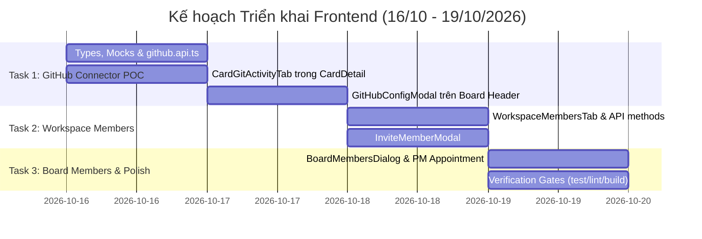

# KẾ HOẠCH HÀNH ĐỘNG FRONTEND — GIAI ĐOẠN HIỆN TẠI (PHASE 1)

> **Dành riêng cho:** Frontend Developer  
> **Repository:** `d:\Document\TÀI LIỆU ĐỒ ÁN 1\Nexora\Frontend`  
> **Thời điểm hiện tại:** 15/10/2026  
> **Trọng tâm giai đoạn:**  
> 1. **Phase 1 — Tích hợp GitHub Connector (13/10/2026 – 19/10/2026):** Triển khai giao diện kết nối GitHub và hiển thị Git commits trên thẻ bài (Proof of Concept) — **Hạn chót: 19/10/2026 (Còn 4 ngày)**.  
> 2. **Bù đắp các thiếu sót của Phase 1 Core (Quá hạn 12/10):** Hoàn thiện Tab Quản lý Thành viên Workspace và Dialog Quản lý Thành viên Board.

---

## MỤC LỤC

1. [Tổng quan Bối cảnh & Mục tiêu](#1-tổng-quan-bối-cảnh--mục-tiêu)
2. [Task 1: Triển khai GitHub Connector POC (P0 — Hạn chót 19/10)](#task-1-triển-khai-github-connector-poc-p0--hạn-chót-1910)
   - [1.1. Khởi tạo Types & DTOs](#11-khởi-tạo-types--dtos)
   - [1.2. Tạo Mock Data & Fixtures](#12-tạo-mock-data--fixtures)
   - [1.3. Xây dựng API Client Layer](#13-xây-dựng-api-client-layer)
   - [1.4. Xây dựng Modal Cấu hình GitHub trên Board](#14-xây-dựng-modal-cấu-hình-github-trên-board)
   - [1.5. Xây dựng Tab "Git Activity" trong Chi tiết Thẻ (CardDetailDrawer)](#15-xây-dựng-tab-git-activity-trong-chi-tiết-thẻ-carddetaildrawer)
3. [Task 2: Hoàn thiện Quản lý Thành viên Workspace (P1 — Bù đắp Phase 1)](#task-2-hoàn-thiện-quản-lý-thành-viên-workspace-p1--bù-đắp-phase-1)
   - [2.1. Bổ sung API Client cho Thành viên & Lời mời](#21-bổ-sung-api-client-cho-thành-viên--lời-mời)
   - [2.2. Xây dựng Component WorkspaceMembersTab thay thế Placeholder](#22-xây-dựng-component-workspacememberstab-thay-thế-placeholder)
   - [2.3. Xây dựng Modal Mời Thành viên (InviteMemberModal)](#23-xây-dựng-modal-mời-thành-viên-invitemembermodal)
4. [Task 3: Hoàn thiện Quản lý Thành viên Board (P1 — Bù đắp Phase 1)](#task-3-hoàn-thiện-quản-lý-thành-viên-board-p1--bù-đắp-phase-1)
   - [3.1. Nâng cấp Nút "Share / Members" trên BoardDetailHeader](#31-nâng-cấp-nút-share--members-trên-boarddetailheader)
   - [3.2. Xây dựng Dialog Quản lý Thành viên Board & Bổ nhiệm PM](#32-xây-dựng-dialog-quản-lý-thành-viên-board--bổ-nhiệm-pm)
5. [Lịch Trình Thực Thi 4 Ngày (16/10 – 19/10/2026)](#5-lịch-trình-thực-thi-4-ngày-1610--19102026)
6. [Tiêu Chí Nghiệm Thu (Definition of Done)](#6-tiêu-chí-nghiệm-thu-definition-of-done)

---

## 1. TỔNG QUAN BỐI CẢNH & MỤC TIÊU

Hôm nay là **15/10/2026**. Bạn phụ trách toàn bộ **Frontend**, mục tiêu cấp bách của bạn trong 4 ngày tới là:
- Đưa tiến độ **GitHub Connector Frontend từ 0% lên 100% hoàn thành POC** trước ngày 19/10 để có sản phẩm demo trực tiếp (kết nối repo, nhận commit liên kết với thẻ bài `NEX-xxx` / `CARD-xxx`).
- Xóa bỏ trạng thái *"Under development"* ở Tab **Members** trên `BoardsPage.tsx` bằng một giao diện quản lý thành viên và mời thành viên hoàn chỉnh.
- Thay thế chức năng copy link tạm bợ của nút **"Share / Members"** trên Board Header bằng hộp thoại quản lý thành viên Board thực thụ.

---

## TASK 1: TRIỂN KHAI GITHUB CONNECTOR POC (P0 — HẠN CHÓT 19/10)

Mục tiêu: Cho phép người dùng kết nối repository GitHub vào Board dự án, và khi mở bất kỳ thẻ bài nào (ví dụ `NEX-101`), người dùng có thể xem được lịch sử commit hoặc pull request có nhắc đến mã thẻ đó.

### 1.1. Khởi tạo Types & DTOs
- **Tệp cần tạo:** `src/types/github.ts`
- **Tệp cần cập nhật:** `src/types/index.ts` (export thêm `./github`)
- **Nội dung cần định nghĩa:**
  ```typescript
  export interface GitHubConfig {
    boardId: string;
    repositoryName: string; // e.g. "nexora-org/nexora-frontend"
    webhookUrl: string;     // e.g. "https://api.nexora.local/api/v1/github/webhooks"
    isActive: boolean;
    createdAt?: string;
    updatedAt?: string;
  }

  export interface GitHubConfigRequest {
    repositoryName: string;
    webhookSecret: string;
  }

  export type GitActivityType = "COMMIT" | "PULL_REQUEST";

  export interface GitActivityItem {
    id: string;
    cardId: string;
    type: GitActivityType;
    identifier: string;    // Short commit SHA (e.g. "a28b92a") hoặc PR "#12"
    message: string;       // Commit message (e.g. "feat: implement card detail drawer #NEX-101")
    author: string;        // e.g. "datphan"
    authorAvatarUrl?: string;
    url: string;           // Link mở commit trên GitHub (e.g. "https://github.com/...")
    timestamp: string;     // ISO Date
  }

  export interface GitActivityListResponse {
    success: boolean;
    data: GitActivityItem[];
  }
  ```

---

### 1.2. Tạo Mock Data & Fixtures
- **Tệp cần tạo:** `src/mocks/data/github.mock.ts`
- **Mục đích:** Giúp Frontend có dữ liệu hiển thị và viết Unit Test ngay lập tức mà không phải chờ Backend dựng xong server.
- **Nội dung cần có:**
  - Mock cấu hình `MOCK_GITHUB_CONFIG` cho board `board-website-redesign`:
    - `repositoryName`: `"nexora-org/nexora-platform"`
    - `webhookUrl`: `"http://localhost:3000/api/v1/github/webhooks"`
    - `isActive`: `true`
  - Mock commits `MOCK_GIT_ACTIVITIES`:
    - Commit cho `NEX-101` (Card ID `card-nex-101`):
      `"feat(copy): finalize landing page hero copy #NEX-101"`, SHA `7d70105`, author `datphan`, timestamp `2026-10-14T09:30:00Z`.
    - Commit cho `NEX-104` (Card ID `card-nex-104`):
      `"fix(pricing): calculate discount tiers correctly #NEX-104"`, SHA `95eeaaf`, author `baonguyen`, timestamp `2026-10-15T08:15:00Z`.
    - Pull Request cho `NEX-104`:
      `"PR #15: Pricing calculator logic & responsive layout"`, PR `#15`, author `baonguyen`, type `PULL_REQUEST`.

---

### 1.3. Xây dựng API Client Layer
- **Tệp cần tạo:** `src/apis/github.api.ts`
- **Tệp cần cập nhật:** `src/apis/index.ts`
- **Các phương thức cần viết (khớp 100% với đặc tả OpenAPI `github.yaml`):**
  - `getGitHubConfig(boardId: string): Promise<GitHubConfig | null>`
    - Gọi: `GET /api/v1/boards/${boardId}/github/config`
  - `configureGitHub(boardId: string, payload: GitHubConfigRequest): Promise<GitHubConfig>`
    - Gọi: `POST /api/v1/boards/${boardId}/github/config`
  - `disconnectGitHub(boardId: string): Promise<void>`
    - Gọi: `DELETE /api/v1/boards/${boardId}/github/config`
  - `getCardGitActivity(cardId: string): Promise<GitActivityItem[]>`
    - Gọi: `GET /api/v1/cards/${cardId}/git-activity`
    - Có cơ chế fallback về `MOCK_GIT_ACTIVITIES` khi server trả về lỗi hoặc chưa triển khai endpoint để không làm gián đoạn trải nghiệm UI.

---

### 1.4. Xây dựng Modal Cấu hình GitHub trên Board
- **Tệp cần tạo:** `src/components/kanban/GitHubConfigModal.tsx`
- **Vị trí tích hợp:** Thêm tùy chọn *"GitHub Settings"* vào Menu 3 chấm của `BoardDetailHeader.tsx` hoặc nút bấm riêng bên cạnh nút Share.
- **Yêu cầu giao diện & Trải nghiệm:**
  - Tiêu đề: *"GitHub Integration (Proof of Concept)"* với logo GitHub (icon `GitBranch` / `Github` từ `lucide-react`).
  - **Trường 1: Repository Name:** Ô nhập text có placeholder `owner/repository` (ví dụ `NEXORA-UIT/Nexora`), validate không được để trống.
  - **Trường 2: Webhook Secret:** Ô nhập mật khẩu / chuỗi bí mật HMAC dùng để xác thực an toàn.
  - **Trường 3: Payload URL (Chỉ đọc & Nút Copy):**
    Hiển thị sẵn URL: `http://localhost:3000/api/v1/github/webhooks` kèm nút bấm `Copy Webhook URL` có icon `Copy`/`Check` và toast thông báo *"Webhook URL copied!"*.
  - **Trạng thái khi đã kết nối:**
    - Hiển thị badge xanh `● Connected to owner/repo`.
    - Nút màu đỏ `Disconnect Repository` kèm cảnh báo xác nhận.
  - Xử lý submit với loading spinner và toast alert qua `sonner`.

---

### 1.5. Xây dựng Tab "Git Activity" trong Chi tiết Thẻ (CardDetailDrawer)
- **Tệp cần tạo:** `src/components/kanban/detail/activity/CardGitActivityTab.tsx`
- **Tệp cần chỉnh sửa:** 
  - `src/components/kanban/detail/CardDetailActivity.tsx`
  - `src/components/kanban/detail/CardDetailDrawer.tsx`
- **Thiết kế chi tiết:**
  - Thêm tab thứ 3 trong thanh tab của Activity: `Comments`, `History`, và tab mới `Code / Git` (icon `GitCommit`).
  - Kèm badge số lượng commit (ví dụ: `Code (2)`).
  - **Từng dòng Commit hiển thị:**
    - Icon commit hoặc PR (`GitCommit` màu xanh tím hoặc `GitPullRequest` màu xanh lá).
    - Tiêu đề commit: Highlight mã thẻ `#NEX-101` bằng màu đậm hoặc badge.
    - Dòng thông tin phụ: Mã short SHA trong chip font `monospace` (`a28b92a`), tên tác giả git, thời gian tương đối (`2 hours ago` hoặc `Oct 14`).
    - Nút bấm / Link ngoài `Open in GitHub` (icon `ExternalLink`) mở link commit trên tab mới an toàn (`rel="noopener noreferrer"`).
  - **Empty State khi chưa có commit:**
    - Icon `GitCommit` mờ.
    - Dòng chữ: *"Chưa có commit hoặc pull request nào nhắc đến mã thẻ này."*
    - Gợi ý: *"Hãy thêm #NEX-xxx vào nội dung commit message khi push code để tự động liên kết."*

---

## TASK 2: HOÀN THIỆN QUẢN LÝ THÀNH VIÊN WORKSPACE (P1 — BÙ ĐẮP PHASE 1)

Mục tiêu: Xóa bỏ thông báo *"Under development"* khi người dùng click vào Tab **Members** trên trang `BoardsPage.tsx`.

### 2.1. Bổ sung API Client cho Thành viên & Lời mời
- **Tệp cần chỉnh sửa:** `src/apis/workspace.api.ts`
- **Các phương thức cần bổ sung:**
  ```typescript
  // 1. Mời thành viên mới qua email
  async inviteWorkspaceMember(workspaceId: string, email: string, role: "MEMBER" = "MEMBER"): Promise<void>

  // 2. Xóa thành viên khỏi Workspace (Owner only)
  async removeWorkspaceMember(workspaceId: string, userId: string): Promise<void>

  // 3. Rời khỏi Workspace (Member tự rời)
  async leaveWorkspace(workspaceId: string): Promise<void>

  // 4. Lấy danh sách lời mời đang chờ (Pending Invitations)
  async listWorkspaceInvitations(workspaceId: string): Promise<WorkspaceInvitation[]>

  // 5. Hủy lời mời
  async cancelWorkspaceInvitation(workspaceId: string, invitationId: string): Promise<void>
  ```

---

### 2.2. Xây dựng Component WorkspaceMembersTab thay thế Placeholder
- **Tệp cần tạo:** `src/components/workspace/WorkspaceMembersTab.tsx`
- **Tệp cần cập nhật:** `src/pages/boards/BoardsPage.tsx`
  - Thay thế khối code placeholder tại dòng 303-312 bằng `<WorkspaceMembersTab workspace={workspace} />` khi `activeTab === "members"`.
- **Yêu cầu giao diện:**
  - **Header phần thành viên:**
    - Tiêu đề *"Workspace Members"* kèm số lượng thành viên.
    - Ô tìm kiếm thành viên theo tên hoặc email.
    - Nút bấm chính `+ Invite Members` (nền xanh, icon `UserPlus`) mở `InviteMemberModal`.
  - **Bảng danh sách thành viên hiện tại (Active Members):**
    - Cột 1: Thành viên (Avatar tròn chữ cái viết hoa, Họ tên đậm, Email nhạt).
    - Cột 2: Vai trò (Badge `OWNER` màu tím/xanh đậm hoặc `MEMBER` màu xám trung tính).
    - Cột 3: Ngày tham gia.
    - Cột 4: Thao tác (Menu 3 chấm):
      - Nếu là Owner: Có tùy chọn *"Remove from workspace"*.
      - Không cho phép tự xóa chính mình nếu là Owner duy nhất.
  - **Khu vực Lời mời đang chờ (Pending Invitations - nếu có):**
    - Hiển thị danh sách các email đã gửi lời mời nhưng chưa chấp nhận, kèm nút *"Revoke"* (Hủy lời mời) và thời hạn còn lại (ví dụ: *"Expires in 5 days"*).

---

### 2.3. Xây dựng Modal Mời Thành viên (InviteMemberModal)
- **Tệp cần tạo:** `src/components/workspace/InviteMemberModal.tsx`
- **Yêu cầu giao diện:**
  - Hộp thoại Radix Dialog kích thước vừa phải (max-w-md), nền trắng, bo góc 2xl.
  - Form nhập liệu:
    - **Email Address:** Ô nhập email, tự động autofocus, validate đúng định dạng email RFC.
    - **Role:** Dropdown chọn vai trò (Mặc định là `Member`).
  - Nút bấm: `Cancel` và `Send Invitation`.
  - Xử lý gửi API: Hiển thị loading spinner trên nút bấm, đóng modal khi thành công và bắn toast: *"Invitation sent to user@example.com"*, đồng thời tự động cập nhật danh sách lời mời.

---

## TASK 3: HOÀN THIỆN QUẢN LÝ THÀNH VIÊN BOARD (P1 — BÙ ĐẮP PHASE 1)

Mục tiêu: Thay thế hành vi chỉ copy link của nút **"+ Share / Members"** trên bảng Kanban bằng hộp thoại quản lý thành viên thực sự.

### 3.1. Nâng cấp Nút "Share / Members" trên BoardDetailHeader
- **Tệp cần chỉnh sửa:** `src/components/kanban/BoardDetailHeader.tsx` và `src/pages/boards/BoardDetailPage.tsx`
- Khi người dùng click `Share / Members`, mở hộp thoại `BoardMembersDialog`.

---

### 3.2. Xây dựng Dialog Quản lý Thành viên Board & Bổ nhiệm PM
- **Tệp cần tạo:** `src/components/kanban/BoardMembersDialog.tsx`
- **Yêu cầu giao diện:**
  - Tiêu đề: *"Board Members & Access"* (`Website Redesign`).
  - **Danh sách thành viên hiện tại của Board:**
    - Hiển thị avatar, tên, email.
    - Tag vai trò trong Board:
      - `PM` (Project Manager): Badge màu xanh lam nổi bật.
      - `Member`: Badge thường.
    - Nút chỉ định PM (`Make PM`): Chỉ Workspace Owner mới có quyền chuyển giao PM cho người khác (gọi `boardApi.assignBoardPm`).
    - Nút gỡ khỏi Board (`Remove from board`): Loại bỏ quyền truy cập của người đó vào Board này (gọi `boardApi.removeBoardMember`).
  - **Thêm thành viên mới vào Board:**
    - Dropdown liệt kê các thành viên thuộc Workspace nhưng chưa có trong Board này.
    - Nút `Add to Board` để thêm nhanh thành viên vào dự án.
  - **Tab Chia sẻ Link:**
    - Giữ lại ô input chứa URL của Board kèm nút `Copy Link` tiện lợi cho người dùng muốn chia sẻ nhanh.

---

## 5. LỊCH TRÌNH THỰC THI 4 NGÀY (16/10 – 19/10/2026)

Để không bị quá tải và hoàn thành đúng hạn 19/10, bạn hãy chia công việc theo từng ngày:



- **Ngày 1 (Thứ Sáu 16/10):**
  - Tạo `src/types/github.ts` và `src/mocks/data/github.mock.ts`.
  - Viết `src/apis/github.api.ts`.
  - Xây dựng component `CardGitActivityTab.tsx` và gắn vào `CardDetailDrawer.tsx`.
  - *Kết quả ngày 1:* Mở thẻ `NEX-101` hoặc `NEX-104` là thấy tab Code hiển thị các commit mẫu đẹp mắt.
- **Ngày 2 (Thứ Bảy 17/10):**
  - Xây dựng `GitHubConfigModal.tsx` và gắn vào `BoardDetailHeader.tsx`.
  - Kiểm tra luồng nhập repo, lưu cấu hình, copy Webhook URL.
  - *Kết quả ngày 2:* Hoàn tất 100% UI cho GitHub Connector POC, sẵn sàng kết nối API thật.
- **Ngày 3 (Chủ Nhật 18/10):**
  - Bổ sung các hàm thành viên vào `src/apis/workspace.api.ts`.
  - Viết `WorkspaceMembersTab.tsx` thay thế khối placeholder trong `BoardsPage.tsx`.
  - Viết `InviteMemberModal.tsx` để gửi lời mời thành viên.
  - *Kết quả ngày 3:* Tab Members trên Workspace hiển thị danh sách thành viên thực tế và mời được thành viên mới.
- **Ngày 4 (Thứ Hai 19/10 — Deadline):**
  - Viết `BoardMembersDialog.tsx` để quản lý thành viên Board và chuyển PM.
  - Chạy toàn bộ các cổng kiểm tra tự động:
    ```bash
    npm run typecheck
    npm run lint
    npm run test -- --run
    npm run build
    ```
  - Chụp ảnh hoặc quay video ngắn minh chứng hoàn thành bàn giao Phase 1.

---

## 6. TIÊU CHÍ NGHIỆM THU (DEFINITION OF DONE)

Một tính năng được coi là hoàn tất khi:
1. **TypeScript Strict:** Không có lỗi kiểu dữ liệu (`0 errors` khi chạy `npm run typecheck`), không dùng `as any`.
2. **Trải nghiệm mượt mà:** Có trạng thái Loading (Skeleton / Spinner), có Empty State rõ ràng khi không có dữ liệu, có Toast thông báo khi thực hiện thao tác.
3. **Resilience (Khả năng chịu lỗi):** Nếu Backend chưa mở API thật hoặc lỗi mạng, UI không bị crash trắng trang mà fallback hiển thị dữ liệu mẫu hoặc thông báo lỗi thân thiện kèm nút Retry.
4. **Không breaking changes:** Giữ vững 570 unit tests hiện có luôn PASS 100%.
